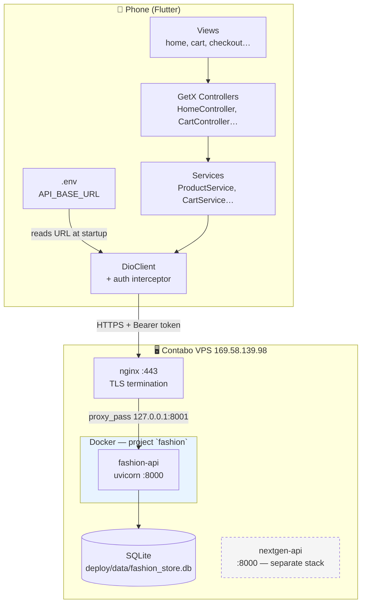
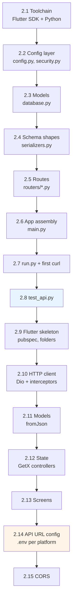
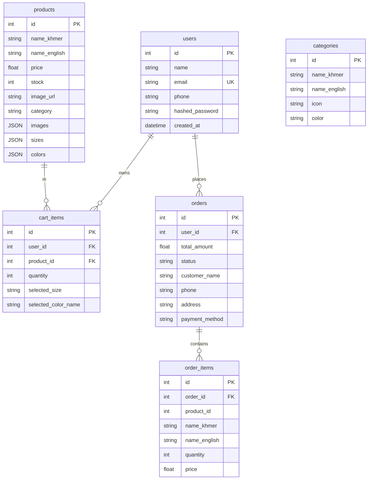
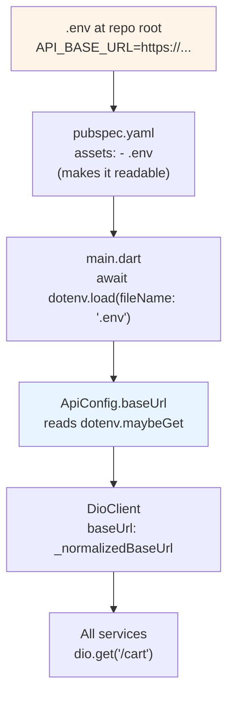
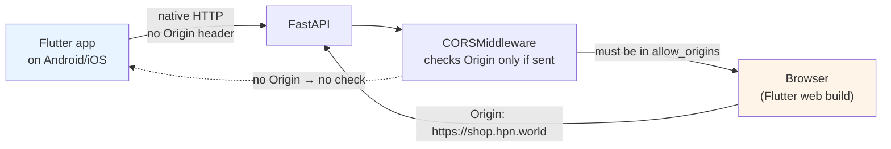
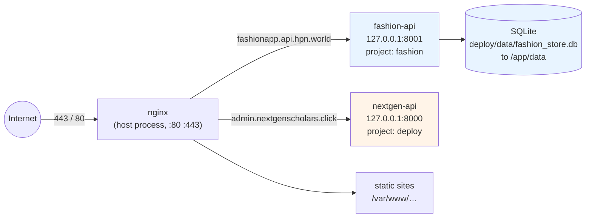
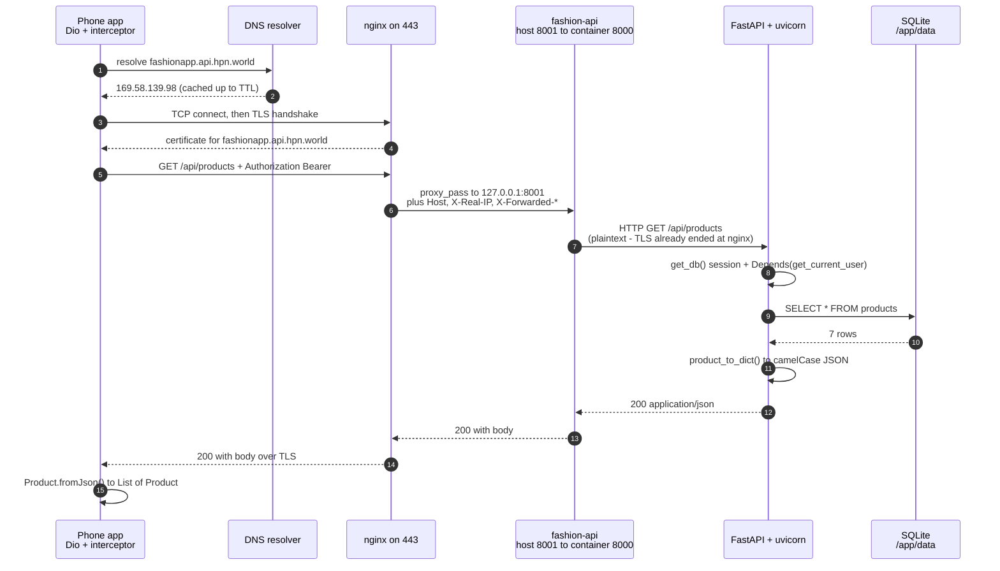

# Understanding `fashion_app` — a senior engineer's walkthrough

A guide to what you actually built. Everything here is checked against the real
files in this repo — file names, ports, commands and config values are quoted
from them, not invented.

**How to read this.** Each concept gets a plain-English definition, an analogy,
and where it lives in *this* project. Each section ends with the mistakes that
actually bite. Where the repo doesn't answer something, it goes in
[Open questions](#10-open-questions) instead of being guessed at.

**Deployment status (2026-09-29):** live at `https://fashionapp.api.hpn.world/api`,
Let's Encrypt cert valid to 2026-12-28, `verify_live.py` passing 23/23.

---

## Table of contents

1. [Project overview & architecture](#1-project-overview--architecture)
2. [Build it step by step](#2-build-it-step-by-step)
3. [Deployment guide](#3-deployment-guide)
4. [Networking & infra glossary](#4-networking--infra-glossary)
5. [Daily operations](#5-daily-operations)
6. [Troubleshooting playbook](#6-troubleshooting-playbook)
7. [Security review of this repo](#7-security-review-of-this-repo)
8. [What to learn next](#8-what-to-learn-next)
9. [Commands worth memorising](#9-commands-worth-memorising)
10. [Open questions](#10-open-questions)
11. [Question bank](#11-question-bank)

---

## 1. Project overview & architecture

### What this is

A bilingual (Khmer/English) fashion store: a **Flutter** mobile app talking to a
**FastAPI** REST API backed by **SQLite**, deployed on a **Contabo VPS** behind
**nginx** with a **Let's Encrypt** certificate.

Three separate pieces, three separate concerns:

| Piece | Lives in | Job |
|---|---|---|
| Mobile app | `lib/` | UI, state, user input |
| REST API | `backend/app/` | Business rules, auth, database |
| Server config | `backend/deploy/` | Docker, nginx, deploy scripts |

### Architecture



Read the dashed `nextgen-api` box carefully — that's the **other** project on the
same server, and section 3 explains why keeping the two apart is the single most
important operational fact about this deployment.

### Request flow: adding a product to the cart

```mermaid
sequenceDiagram
    participant U as User
    participant V as HomeView
    participant C as HomeController
    participant CS as CartService
    participant D as Dio
    participant N as nginx
    participant A as fashion-api
    participant DB as SQLite

    U->>V: taps + on a product card
    V->>C: addProductToCart(product)
    C->>C: guard: stock > 0?
    C->>CS: addToCart(productId, quantity, size, colour)
    CS->>D: POST /api/cart
    Note over D: interceptor attaches<br/>Authorization: Bearer &lt;token&gt;
    D->>N: HTTPS → fashionapp.api.hpn.world
    N->>A: proxy_pass → 127.0.0.1:8001
    A->>A: Depends(get_current_user)<br/>→ decode JWT → load User
    A->>DB: SELECT product, SELECT existing cart row
    A->>DB: INSERT or UPDATE + COMMIT
    A-->>D: 200 + cart item JSON (camelCase)
    D-->>C: parsed Map
    C-->>U: Get.snackbar "បានបន្ថែម ទៅកន្ត្រក"
```

### The directory layout, and why

```
fashion_app/
├── lib/
│   ├── main.dart              # entry point; loads .env, sets up GetMaterialApp
│   ├── core/                  # cross-cutting: config, network, routing, stores
│   │   ├── api_config.dart    # reads API_BASE_URL from .env
│   │   ├── network/dio_client.dart
│   │   ├── routes/            # app_routes.dart (names), app_pages.dart (widgets)
│   │   ├── bindings/          # app_binding.dart — app-wide dependencies
│   │   └── stores/            # SessionController, FavoritesStoreController
│   ├── features/              # ONE FOLDER PER SCREEN
│   │   └── home/
│   │       ├── home_binding.dart      # creates HomeController
│   │       ├── home_controller.dart   # state + logic
│   │       └── home_view.dart         # pixels only
│   ├── models/                # plain Dart classes (Product, CartItem…)
│   ├── services/api/          # one file per API area
│   └── widgets/               # shared UI (product_card)
├── backend/
│   ├── app/
│   │   ├── main.py            # FastAPI app, CORS, router registration
│   │   ├── serializers.py     # ORM rows → the exact JSON the app expects
│   │   ├── core/
│   │   │   ├── config.py      # pydantic-settings, reads .env
│   │   │   ├── database.py    # SQLAlchemy models + auto-seed
│   │   │   └── security.py    # bcrypt + JWT
│   │   └── routers/           # auth, products, categories, cart, orders
│   ├── deploy/                # ← all server config lives here
│   └── test_api.py            # 49-check smoke test
└── about_fashion_app/          # notes (RUNBOOK, this file)
```

**Key idea: the `features/<name>/{binding,controller,view}` triple.**

*Definition:* GetX splits each screen into three files by responsibility —
`binding` constructs the controller, `controller` holds state and logic, `view`
renders.

*Analogy:* like a restaurant menu: the **binding** is the host seating you, the
**controller** is the kitchen doing the work, the **view** is the table getting
the plate. The kitchen never touches the table directly.

*In this repo:* `home_binding.dart` registers `HomeController`, which owns the
`products` list and calls `ProductService`; `home_view.dart` only reads
`controller.products` and draws. No network call ever appears in a `_view.dart`.

### Concepts you should be able to explain

**REST** — An architectural style where each URL is a *thing* and the HTTP verb
is the *action*: `POST /api/orders` creates an order, `GET /api/orders` lists
yours.

*Analogy:* a filing cabinet. The drawer (`/api/orders`) holds papers (orders);
`GET` reads them, `POST` files a new one. You never call "edit drawer 3".

*Here:* `backend/app/main.py:27-31` mounts five routers, each a drawer.

**MVC / separation of concerns** — Splitting an app so data, logic and pixels
change independently.

*Analogy:* a car engine, gearbox and body. Swap the body, the engine still runs.

*Here:* `serializers.py` translates `name_khmer` → `nameKhmer` in one place, so
renaming a database column doesn't mean touching 12 widget files.

**JWT (JSON Web Token)** — A signed JSON blob the server hands back after login.
The client sends it on every later request; the server verifies the signature
instead of re-checking the password.

*Analogy:* a stamped, tamper-evident pass. The guard checks the seal, not your
ID.

*Here:* `security.py:26-28` creates it, `session_controller.dart:28` caches it,
`dio_client.dart:31-37` attaches it automatically.

**Environment variable** — Configuration read from outside the code so the same
build works in dev and production.

*Analogy:* a thermostat setting, not a rewired furnace.

*Here:* `.env` sets `API_BASE_URL`; `api_config.dart:8` reads it at runtime.

**Dependency injection (`Depends`)** — A function declares what it needs, and
the framework supplies it.

*Analogy:* a restaurant orders "one waiter" rather than hiring one.

*Here:* `get_cart(current: User = Depends(get_current_user), db: Session =
Depends(get_db))` — `cart.py:24` asks for both and gets them for free.

### Common mistakes / troubleshooting

| Mistake | Symptom | Where to look |
|---|---|---|
| Network call in a `_view.dart` | Slow UI, untestable | Move it to the controller |
| Two sources of truth for state | Flickering UI | Delete the duplicate; GetX state is the truth |
| Forgetting `onClose()` | Memory grows, timers keep firing | `home_controller.dart:31-35` shows the pattern |

---

## 2. Build it step by step

Rebuilding this project from an empty folder, **in the order it was actually
built**. Two commits tell that story honestly:

- `bb4a490` "Initial commit" — Flutter scaffolding, `lib/screens/*` flat layout,
  static `UserSession`/`FavoritesStore`, no backend.
- `5dab590` "Rewrite app on GetX/Dio…" — the current shape: feature-based
  `lib/features/*`, `core/network`, and the whole FastAPI backend added.

So the real sequence was **Flutter first, backend second**, then a rewrite of
both. The guide below follows a slightly better order — backend first — because
it lets you prove the API works with `curl` before any UI exists. I've flagged
where that differs from history.

Every step has: **Goal → Files → Command → Expected result → Checkpoint**.

---

### 2.0 The order at a glance



Blue = the backend is testable on its own. Orange = the part that bites hardest,
and the part that differs most between your Mac, an emulator, and production.

---

### 2.1 Toolchain

**Goal:** get two independent toolchains running before writing any project code.

**Files:** none yet — just `fashion_app/` and `backend/` directories.

#### Flutter side

```bash
flutter --version          # confirm the SDK exists
flutter doctor             # what it flags, and whether it matters
flutter create fashion_app # only if starting from nothing
cd fashion_app
flutter pub get
```

**Flag by flag:**
- `flutter doctor` — checks each toolchain (Android SDK, Xcode, Chrome) and
  flags problems. Red doesn't always block you; only the *current platform* you
  want to run on matters. To run on iOS you need Xcode; Chrome-only is fine for
  web.
- `flutter create` — scaffolds platform folders (`android/`, `ios/`, `web/`)
  with correct Gradle/Podfile boilerplate. Never hand-write these.

> **Honesty note:** Git doesn't record the original scaffold command, so treat
> `flutter create` as the modern equivalent for *reproducing* this, not as a
> verbatim history. Commit `bb4a490` contains the generated `android/`, `ios/`
> and `web/` folders, but nothing tells you which flags were passed. `pubspec.yaml`
> is the better source of truth for what the project actually depends on.

The four dependencies that shape this project's design, from `pubspec.yaml`:

| Package | Why this project needs it |
|---|---|
| `get: ^4.7.2` | routing + dependency injection + reactive state — the whole architecture |
| `dio: ^5.7.0` | HTTP client with interceptors, needed to attach the JWT to every request |
| `flutter_dotenv: ^5.2.1` | reads `.env` at runtime so the API URL isn't compiled in |
| `shared_preferences` | persists login session across app restarts |

#### Python side

```bash
cd backend
python3 -m venv .venv
source .venv/bin/activate          # Windows: .venv\Scripts\activate
pip install -r requirements.txt
```

**Flag by flag:**
- `python3 -m venv .venv` — a folder containing its own Python interpreter and
  packages. Keeps this project's 9 direct requirements (and the ~40 transitive
  ones pip pulls with them) away from your system Python and from every other
  project on your Mac. *Analogy: a labelled toolbox per craft.*
- `source .venv/bin/activate` — repoints `python` and `pip` at that toolbox. Not
  optional: skip it and `pip install` writes to the wrong place, then
  `ModuleNotFoundError: fastapi`.
- `pip install -r requirements.txt` — `-r` reads the list from a file.

**What `requirements.txt` pins, and why it matters here:**

```
passlib[bcrypt]==1.7.4
bcrypt==4.0.1
python-jose[cryptography]==3.3.0
```

These are **exact** pins while the rest use `>=`. That isn't sloppiness — it's a
known incompatibility: `passlib 1.7.4` breaks against `bcrypt 5.x`. Loosening
those two lines to `>=` breaks password hashing at runtime.

**Expected result:** `python -c "import fastapi, uvicorn, sqlalchemy; print('ok')"`
prints `ok`.

**Checkpoint:**
```bash
source .venv/bin/activate && which python
# → backend/.venv/bin/python     ← the venv, not /usr/bin/python
flutter analyze
# → No issues found!  (or 0 issues) — a clean baseline before you add code
```
> If `which python` shows `/usr/bin/python`, the venv isn't active. Everything
> after this point will install to the wrong place.

---

### 2.2 Configuration and security, before any route

**Goal:** make every secret and setting come from outside the code, and build the
two primitives (hashing, tokens) that auth depends on.

**Files:**
- `backend/.env` (from `.env.example`)
- `backend/app/core/config.py`
- `backend/app/core/security.py`
- `backend/app/__init__.py`, `backend/app/core/__init__.py` (empty)

#### The `.env` file

```bash
cp .env.example .env
```

```ini
DEBUG=true                        # reload on save — dev only
CORS_ORIGINS=*
DATABASE_URL=sqlite:///./fashion_store.db
SECRET_KEY=change-me-to-a-long-random-string
TOKEN_EXPIRE_HOURS=24
```

`DEBUG=true` locally, `false` in production. `DEBUG=true` in production keeps
uvicorn's auto-reloader alive (slower, more memory) and is a footgun.

#### `config.py` — the part that surprises everyone

```python
BACKEND_DIR = Path(__file__).resolve().parent.parent.parent

class Settings(BaseSettings):
    model_config = SettingsConfigDict(
        env_file=BACKEND_DIR / ".env",
        extra="ignore",
    )
    debug: bool = False
    secret_key: str = "fashion-store-secret-2026-change-me"
    algorithm: str = "HS256"
    token_expire_hours: int = 24
```

**Why the path arithmetic:** `__file__` is `backend/app/core/config.py`.
`.parent` → `core/`, `.parent` → `app/`, `.parent` → `backend/`. Without this,
the `.env` location would depend on your **current working directory** — run
uvicorn from the repo root instead of `backend/` and it silently fails to find
config. This is the single most common "works on my machine" bug in Python
projects.

**Why field names are lowercase with no prefix:** `pydantic-settings` maps
`secret_key` to the env var `SECRET_KEY` automatically. Writing `base_url: str`
would read `BASE_URL`. The mapping is case-insensitive on the env-var side.

**The precedence rule — and why `test_api.py` depends on it:** real environment
variables beat `.env` file values. `config.py:1-6` documents this explicitly
because `test_api.py:8` sets `DATABASE_URL` *before* importing the app, and
relies on winning. Without this rule the tests would wipe your dev database.

#### `security.py` — hashing and tokens

```python
pwd_context = CryptContext(schemes=["bcrypt"], deprecated="auto")

def hash_password(p):  return pwd_context.hash(p)
def verify_password(plain, hashed): return pwd_context.verify(plain, hashed)

def create_token(data: dict) -> str:
    payload = {**data, "exp": datetime.utcnow() + timedelta(hours=EXPIRE_HOURS)}
    return jwt.encode(payload, SECRET_KEY, algorithm=ALGORITHM)

def get_current_user(creds = Depends(security), db = Depends(get_db)) -> User:
    payload = decode_token(creds.credentials)
    user = db.query(User).filter(User.id == int(payload["sub"])).first()
    if not user:
        raise HTTPException(status_code=401, detail="User not found")
    return user
```

**Concepts:**

- **bcrypt hashing** — one-way: the database stores a hash, never the password.
  Verifying re-hashes the input and compares. You cannot recover a password from
  a hash, only check a guess.
  *Analogy: a fingerprint, not a photograph.*
- **Salt** — bcrypt embeds a random salt per hash, so identical passwords
  produce different hashes. Defeats precomputed rainbow tables.
- **JWT payload** — here `{"sub": "1", "email": ..., "name": ..., "exp": ...}`.
  `sub` (subject) is the user id. `exp` is the expiry, **enforced by the
  signature**, not by the client.
- **`HTTPBearer`** — FastAPI's extractor: it reads the `Authorization: Bearer
  <token>` header and raises 403 automatically if the header is malformed. (Note:
  it returns 403 for a *missing* header and 401 for a *bad token* — slightly
  inconsistent, but that's FastAPI's behaviour, not a bug in this code.)

**Design decision worth noting:** `get_current_user` re-queries the database on
every authenticated request rather than trusting the token's claims alone. Slower,
but a deleted or banned user loses access immediately instead of at token
expiry. Correct trade-off for a store with real accounts.

**Checkpoint:**
```bash
python -c "
from app.core.security import hash_password, verify_password
h = hash_password('password123')
print('verify correct:', verify_password('password123', h))
print('verify wrong:  ', verify_password('nope', h))
print('hash differs:  ', hash_password('password123') != h)
"
```
```
verify correct: True
verify wrong:   False
hash differs:   True      ← same password, different hash = salting works
```

---

### 2.3 Database models

**Goal:** define the six tables and make them self-create and self-seed, so a
fresh clone has data with zero setup.

**Files:** `backend/app/core/database.py`

#### The six models



*The diagram lists the columns that matter for reading the code, not every
column. The full models also carry `description_khmer`/`description_english`,
`rating` and `reviews` on `Product`, `selected_color_hex` and `created_at` on
`CartItem`, and `created_at` on `User`/`Order`. One relationship detail worth
noting: `Order.items` is declared with `cascade="all, delete-orphan"`, so
deleting an `Order` row deletes its `OrderItem` children in the same statement —
no separate cleanup code.*

**Two decisions to understand, because they're unusual:**

**1. `Product.category` is a plain string, not a foreign key.**

```python
# Free-form category string; must match Category.name_khmer for filtering.
category = Column(String, default="")
```
`products.py:15` filters with `Product.category == category` — exact string
equality against Khmer text. There is **no FK and no constraint** enforcing that
it matches a `Category.name_khmer`. A typo silently yields an empty product list
rather than an error. This is Open Question 1 in §10.

**2. `JSON` columns store variable-shape data.**

```python
images = Column(JSON, default=list)
sizes  = Column(JSON, default=list)   # ["S","M","L"]
colors = Column(JSON, default=list)   # [{"name":"ស","hex":"#FFFFFF"}]
```
Sizes and colours are inherently variable per product, so they're JSON arrays
rather than child tables. The trade-off: **you can't query inside them with SQL**,
and nothing validates their shape. Fine for this data; revisit if you ever need
"show me all products in size XL".

**Why `orders` snapshots name and price:** `order_items` copies `name_khmer`,
`name_english`, `image_url` and `price` at purchase time. So a later price change
or product rename doesn't rewrite your order history. **This is the right pattern
— copy the display data into the order.** It's also why
`OrderItem.product_id` has no FK: the snapshot stands alone.

#### Self-creation and self-seeding

```python
def create_tables():
    Base.metadata.create_all(bind=engine)
    _seed_initial_data()
```

Called from `main.py`'s `lifespan` — so seeding happens on **every start**, but
each insert is guarded:

```python
if not db.query(User).filter(User.email == "sokthyda@gmail.com").first():
    db.add(User(...))
if not db.query(Category).first():
    for ... : db.add(Category(...))
if not db.query(Product).first():
    for ... : db.add(Product(...))
```

Delete the database and it regenerates. Start it twice and nothing duplicates.

**⚠️ The critical limitation:** `create_all()` only creates *missing* tables. It
never *altters* an existing one. Change a column after first launch and your
change is silently ignored — the production table keeps the old shape. This is
why Alembic (Open Question 8) is the top item in §8.

#### Where the file lives

```python
DATABASE_URL=sqlite:///./fashion_store.db   # three slashes = relative
```

Three slashes means "relative to the process's current directory". Run from
`backend/` and you get `backend/fashion_store.db`. In production it's four
slashes for an absolute container path:

```bash
ssh panha "docker exec fashion-api printenv DATABASE_URL"
# sqlite:////app/data/fashion_store.db
```

**Checkpoint:**
```bash
python -c "
from app.core.database import create_tables
create_tables()
from app.core.database import SessionLocal, Product, Category, User
db = SessionLocal()
print('products:  ', db.query(Product).count())
print('categories:', db.query(Category).count())
print('users:     ', db.query(User).count())
"
```
```
products:   7
categories: 5
users:      1
```
Those exact numbers come from the seed loops at `database.py:98-144`. If you see 0 rows,
the guard conditions or the insert loop are wrong.

---

### 2.4 Serializers — the API's public contract

**Goal:** convert ORM rows into exactly the JSON the Flutter models expect, in
one place.

**Files:** `backend/app/serializers.py`

*(Real function, `serializers.py:6-23`, with two lines elided for width — the
`description*`, `rating`, `reviews`, `imageUrl` and `category` keys sit in
between.)*

```python
def product_to_dict(p: Product) -> dict:
    return {
        "id": p.id,
        "nameKhmer": p.name_khmer,          # snake_case in the DB…
        "nameEnglish": p.name_english,      # …camelCase in the API
        # …descriptionKhmer, descriptionEnglish, price, stock, rating, reviews,
        #   imageUrl, category…
        "images": p.images or [],
        "colors": p.colors or [],
        "isFavorite": False,                # always false — see below
    }
```

**Why a separate file:** the database uses `name_khmer` (Python convention); the
Dart `Product` model expects `nameKhmer` (Dart convention). Neither language
should be forced to speak the other's dialect.

Without this layer you'd either rename DB columns to camelCase (odd in Python) or
write `json['name_khmer']` in every widget. Here, renaming a column touches
**one** function.

**Two things to notice:**

1. **Every serializer uses `or ""` / `or []`** — `p.images or []`. A SQL `NULL`
   arriving in Dart as `null` crashes `List.from(null)`. The `or` turns database
   null into an empty Dart-friendly value at the boundary, so the UI never has to
   null-check data it can't actually be null.
2. **`isFavorite` is hardcoded `False`.** Favourites are a per-device concept
   here; the app fills this in locally from `FavoritesStoreController`. They
   will **not** sync across devices. (Open Question 2.)

**Checkpoint:**
```bash
python -c "
from app.core.database import create_tables, SessionLocal, Product
create_tables(); db = SessionLocal()
from app.serializers import product_to_dict
import json; print(json.dumps(product_to_dict(db.query(Product).first()), ensure_ascii=False, indent=2)[:400])
"
```
Actual output (first 400 characters):
```
{
  "id": 1,
  "nameKhmer": "អាវសូត្រសម្រាប់ស្ត្រី",
  "nameEnglish": "White Silk Blouse",
  "descriptionKhmer": "អាវសូត្រពណ៌សទាន់សម័យ ស្រួលពាក់",
  "descriptionEnglish": "A stylish white silk blouse, comfortable for everyday wear.",
  "price": 29.99,
  "stock": 50,
  "rating": 4.7,
  "reviews": 128,
  "imageUrl": "https://picsum.photos/seed/f001/500/600",
  "category": "ម៉ូតស្ត្រី",
  "images": [
```
Every key is camelCase, and the Khmer strings survive the round trip — that's the
whole point of the `or ""` defaults and the `ensure_ascii=False` when printing.
Drop the `[:400]` and you'll also see `sizes`, `colors`, and `isFavorite: false`.

---

### 2.5 Routes

**Goal:** five routers, each a "drawer" of REST endpoints.

**Files:** `backend/app/routers/{products,categories,auth,cart,orders}.py`

Build them in dependency order — read-only endpoints first, because they need no
auth and prove the database works.

#### Start with products (no auth)

```python
@router.get("")
def list_products(search: str | None = None,
                  category: str | None = None,
                  db: Session = Depends(get_db)):
    query = db.query(Product)
    if category:
        query = query.filter(Product.category == category)
    if search:
        like = f"%{search.strip()}%"
        query = query.filter(
            (Product.name_khmer.like(like))
            | (Product.name_english.like(like))
            | (Product.category.like(like))
        )
    return [product_to_dict(p) for p in query.all()]
```

FastAPI reads `?search=` and `?category=` straight from the query string because
you typed them as parameters. The `|` is SQL `OR`. `.like("%silk%")` matches
"anywhere in the string".

**Note what this does *not* do:** it doesn't paginate, doesn't sort, and doesn't
use indexes. Correct for 7 products; revisit at scale (§8).

#### `categories.py` is the simplest file in the project — 10 lines

```python
@router.get("")
def list_categories(db: Session = Depends(get_db)):
    return [category_to_dict(c) for c in db.query(Category).all()]
```
Copy this as the template for any new read-only endpoint.

#### Then auth, which unlocks the rest

```python
class RegisterRequest(BaseModel):
    name: str
    email: str
    phone: str | None = None
    password: str

@router.post("/register")
def register(data: RegisterRequest, db: Session = Depends(get_db)):
    if db.query(User).filter(User.email == data.email.lower().strip()).first():
        raise HTTPException(status_code=400, detail="អ៊ីមែលនេះត្រូវបានប្រើរួចហើយ")
    user = User(name=data.name.strip(), email=data.email.lower().strip(),
                hashed_password=hash_password(data.password))
    ...
```

**Pydantic models are your input validation.** `name: str` makes `name` required
and a string; omit it or send a number and you get a **422** naming the field —
before your function body runs. The 422 body is the best API documentation
available; it echoes your input back.

**`.lower().strip()` on email** — normalises so `A@B.com` and `a@b.com` are the
same account. Get this wrong and users get "email already used" on their second
attempt at registering.

**Two security gaps to note now, both in §7:**
- No password strength requirement — `password: str` accepts `"a"`.
- No rate limiting on `/login`. NextGen has `login_lockout.py`; copy it.

#### Then cart and orders, which need `get_current_user`

```python
@router.get("")
def get_cart(current: User = Depends(get_current_user), db: Session = Depends(get_db)):
    items = db.query(CartItem).filter(CartItem.user_id == current.id).all()
```

**`current.id` in every query is what makes this a per-user cart.** Without it,
every user would see every other user's cart.

**Note the ownership check on every mutation** (`cart.py:70-71`):
```python
ci = db.query(CartItem).filter(CartItem.id == cart_id,
                               CartItem.user_id == current.id).first()
```
Filtering on **both** `id` and `user_id`. This is defence against IDOR — otherwise
user 2 could delete user 1's cart item just by guessing `cart_id=1`. Easy to
forget on a new endpoint, and the failure is silent data loss.

**The merge behaviour in `add_to_cart`** (`cart.py:45-51`): adding the same
product + size + colour increments the existing row instead of creating a
duplicate. Note the query matches on all three variant fields — the same shirt in
size M and size L are correctly separate rows.

#### The one rule worth internalising from `orders.py`

```python
price = p.price                    # ← read from the DATABASE
total += price * req.quantity
```

`OrderItemRequest` *accepts* a `price` field from the client (`orders.py:14`) — and
the handler **ignores it**. This is the single most important line in the backend:
a client that sent `price: 0.01` still gets charged the real price. Never trust a
price, a total, a role, or a discount from the client. Recompute on the server.

**The stock line right below it has the opposite problem:**

```python
p.stock = max(0, p.stock - req.quantity)      # orders.py:59
```

It decrements stock but **never checks whether there is enough**. Order 99 of a
t-shirt with `stock=3` and `max(0, 3-99)` becomes 0, and the order succeeds
anyway. `max(0, ...)` prevents a *negative* number, which is not the same as
preventing overselling. The fix is a guard *before* the loop body mutates
anything:

```python
if req.quantity > p.stock:
    raise HTTPException(status_code=400, detail=f"ស្តុកមិនគ្រប់គ្រាន់សម្រាប់ផលិតផល #{p.id}")
```

Raising inside the loop before `db.commit()` also rolls back the stock already
decremented for earlier items in the same order — which is exactly why
`orders.py:74` clears the cart *after* the loop and the `db.commit()` is last.

**Checkpoint — the API is now testable with curl alone:**
```bash
python run.py          # in another terminal
```
```bash
curl -s http://localhost:8000/api/products | head -c 150
curl -s http://localhost:8000/api/categories | python3 -m json.tool | head
curl -s "http://localhost:8000/api/products?search=silk" | python3 -m json.tool | head
```

---

### 2.6 Assemble the app

**Goal:** create the FastAPI instance, enable CORS, mount the routers.

**Files:** `backend/app/main.py` (35 lines — the smallest, most important file)

```python
@asynccontextmanager
async def lifespan(app: FastAPI):
    create_tables()      # runs on startup — tables + seed
    yield

app = FastAPI(title=settings.app_name, version=settings.app_version, lifespan=lifespan)

app.add_middleware(CORSMiddleware, allow_origins=parse_cors_origins(settings.cors_origins),
                   allow_credentials=True, allow_methods=["*"], allow_headers=["*"])

app.include_router(products.router,  prefix="/api/products",  tags=["Products"])
app.include_router(auth.router,      prefix="/api/auth",      tags=["Auth"])
app.include_router(categories.router, prefix="/api/categories", tags=["Categories"])
app.include_router(cart.router,      prefix="/api/cart",      tags=["Cart"])
app.include_router(orders.router,    prefix="/api/orders",    tags=["Orders"])

@app.get("/")
def root():
    return {"message": "Fashion Store API v1.0", "docs": "/docs"}
```

**`lifespan` instead of `@app.on_event("startup")`** — the modern FastAPI way, and
`@on_event` is deprecated. Context manager: code before `yield` runs at startup,
after it runs at shutdown.

**Why the router prefixes matter:** each file defines `@router.get("")` — a path
that's empty on its own. The prefix in `main.py` supplies `/api/products`. So
`products.py` knows nothing about URL structure, and `main.py` is the single map
of your API.

**`parse_cors_origins`** splits `"a,b"` into a list, trimming and dropping blanks
— turning one env var into what the middleware wants.

**`/docs` is free.** FastAPI auto-generates interactive documentation at
`http://localhost:8000/docs`, with a working "Try it out" form for every
endpoint. That's the fastest way to learn this API — and how I discovered
`/api/orders` needs `items[]` and register needs `name`.

**Checkpoint:**
```bash
curl -s http://localhost:8000/            # {"message":"Fashion Store API v1.0",...}
# open http://localhost:8000/docs in a browser — you should see 5 tag groups
```

---

### 2.7 Run it

**Files:** `backend/run.py`

```python
if __name__ == "__main__":
    uvicorn.run("app.main:app", host="0.0.0.0", port=8000, reload=settings.debug)
```

**Flag by flag:**
- `"app.main:app"` — string form: module `app.main`, attribute `app`. Required
  when using `reload`, because uvicorn re-imports in a subprocess and can't
  share an already-created object.
- `host="0.0.0.0"` — listen on **all** interfaces, not just loopback. Necessary
  for an Android emulator or a phone on your Wi-Fi to reach it. Note the
  Dockerfile keeps this too; exposure is controlled by what binds on the host,
  not inside the container (§3).
- `port=8000` — dev port. Production runs 8000 *inside* the container, published
  as **8001** on the host.
- `reload=settings.debug` — auto-restart on file save, driven by `DEBUG` in
  `.env`. One config value controls both the reloader and nothing else, so you
  can't accidentally leave reload on in production.

**`run.py` isn't in the Docker image** — `.dockerignore` excludes it along with
`test_api.py`. The image runs uvicorn directly via the `CMD` in the Dockerfile.

**Checkpoint:**
```bash
curl -s http://localhost:8000/api/products | python3 -c "import sys,json;print(len(json.load(sys.stdin)),'products')"
# 7 products
```

---

### 2.8 Write the tests

**Goal:** prove the whole API end-to-end with one command, repeatable, without a
phone.

**Files:** `backend/test_api.py` (180 lines, 49 checks)

```python
import os
os.environ["DATABASE_URL"] = "sqlite:///./test_fashion_store.db"   # ← line 9

from fastapi.testclient import TestClient
from app.main import app
from app.core.database import Base, engine

def main():
    Base.metadata.drop_all(bind=engine)      # start from nothing
    with TestClient(app) as client:           # ← entering runs lifespan
        ...
```

#### Why `test_fashion_store.db` exists

**It must be a different database, for three independent reasons:**

1. **`drop_all()` destroys data.** Line 21 wipes every table. Point that at
   `fashion_store.db` and running tests deletes your dev data — including any
   accounts and orders you created by hand.
2. **Isolation.** Tests must be repeatable. A shared database accumulates rows
   between runs, so `check(len(products) > 0)` passes for the wrong reason, or
   a duplicate-email assertion fails because the previous run created that user.
3. **The precedence rule does the work.** Setting `os.environ` **before**
   importing `app.core.config` means the real environment variable beats
   `.env`'s `DATABASE_URL`. This is exactly the behaviour `config.py:1-6`
   documents. If you reorder those two blocks — set the env var *after* the
   import — the tests silently run against your dev database.

**Why `TestClient` instead of running a server:** it runs uvicorn's ASGI app
**in-process**, no port, no network, milliseconds per request. And crucially,
entering the `with` block runs the `lifespan` — so `create_tables()` and seeding
happen automatically, which is why `drop_all()` on the line before is enough.

**What it covers** — 49 checks, verified by running it:

| Group | Checks | Count |
|---|---|---|
| Products | list → 200, seeded, and each of `id`/`nameKhmer`/`nameEnglish`/`price`/`stock`/`images`/`sizes`/`colors` present | 2 + 8 = **10** |
| Categories | → 200 and seeded | **1** |
| Auth | register → 200, returns `access_token` + user, **duplicate email → 400**, **wrong password → 401**, `/auth/me` | **5** |
| Cart | starts empty, add → 200, item field shape, same variant merges, update quantity | **5** |
| Orders | create → 200, **total computed server-side**, items returned, `GET /orders` for user, cart cleared, **bad token → 401**, `?search=blouse` → 200 | **7** |

Two counting traps here, worth knowing before you trust a number:

- **There are only 21 `check(` call sites but 28 printed results.** The Products
  group asserts each of 8 field names inside a `for key in [...]` loop, so one
  call site prints eight lines. Count the `ok - ` lines, not the `grep -c check(`.
- **The `?search=` check prints under the `== Orders ==` banner**, because it sits
  after the last `print("== ... ==")` in the file. The banner doesn't reliably
  describe the group that follows it.

The three negative checks (400, 401, 401) matter as much as the happy path —
they're what prove authentication is actually enforced rather than merely
present.

**Checkpoint:**
```bash
source .venv/bin/activate
python test_api.py
```
```
== Products ==
  ok - GET /api/products -> 200
  ok - products seeded (7)
  ok - product has 'id'
  …
== Categories ==
  ok - GET /api/categories seeded
== Auth: register + login ==
  ok - register -> 200
  ok - register returns access_token + user
  ok - duplicate email -> 400
  ok - wrong password -> 401
  ok - GET /auth/me
== Cart ==
  ok - cart empty initially
  ok - add to cart
  ok - cart item fields match
  ok - re-adding same variant merges quantity
  ok - update cart quantity
== Orders ==
  ok - create order -> 200
  ok - order total computed server-side
  ok - order items present
  ok - GET /orders for user
  ok - cart cleared after order
  ok - bad token -> 401
  ok - search products

ALL SMOKE TESTS PASSED
```
That last line is literally `print("\nALL SMOKE TESTS PASSED")` at
`test_api.py:107`. Count the `ok - ` lines and you should get **49**.

`check()` is just an `assert` plus a print:
```python
def check(cond, msg):                    # test_api.py:15-17
    assert cond, f"FAIL: {msg}"
    print(f"  ok - {msg}")
```
So a failure raises `AssertionError: FAIL: <msg>` with a traceback and a non-zero
exit — which means **you learn only about the first failure per run**, and the
printed count tells you how far it got. Two consequences worth knowing:

- Under `python -O` the assertions are stripped entirely and the script would
  report `ALL SMOKE TESTS PASSED` having verified nothing. Don't run it
  optimised.
- `assert` is fine for a smoke script but wrong for a real suite — under
  `python -O` it's designed to vanish. That's the standard argument for `pytest`
  in §8.

**Confirm your dev data survived:**
```bash
ls -la fashion_store.db test_fashion_store.db
# both exist — only the test one was dropped and rebuilt
```

**Common mistake:** running `test_api.py` from the repo root instead of
`backend/`. The relative DB path then resolves against the wrong directory and
you get a second stray database. Always `cd backend` first.

---

### 2.9 Flutter skeleton

**Goal:** create the folder structure and wire up the pieces that don't need the
API yet.

**Files:** `pubspec.yaml`, `lib/main.dart`, `analysis_options.yaml`

```dart
Future<void> main() async {
  WidgetsFlutterBinding.ensureInitialized();
  try {
    await dotenv.load(fileName: '.env');
  } catch (_) {
    // Keep app running with fallback config if .env is missing.
  }
  runApp(const FashionStoreApp());
}

class FashionStoreApp extends StatelessWidget {
  @override
  Widget build(BuildContext context) {
    return GetMaterialApp(
      initialBinding: AppBinding(),
      initialRoute: AppRoutes.splash,
      getPages: AppPages.pages,
    );
  }
}
```

*(Trimmed for clarity — the real `main()` also calls `SystemChrome
.setPreferredOrientations` to lock the app to portrait and
`setSystemUIOverlayStyle` for the transparent status bar, and `GetMaterialApp`
sets `title`, `theme: AppTheme.lightTheme` and `debugShowCheckedModeBanner:
false`.)*

**`WidgetsFlutterBinding.ensureInitialized()` before any plugin call** —
plugin channels need the binding, and calling `dotenv.load` first throws.

**Two bindings, on purpose:**
- `initialBinding: AppBinding()` — app-wide singletons registered *once*
  (`SessionController`, `FavoritesStoreController`, both `permanent: true`).
- `SplashBinding` etc. — per-route controllers, disposed when the route pops.

Because both stores are `permanent: true`, they survive every route push and
pop, so a logged-in session is never rebuilt mid-navigation.

`splash_binding.dart` has a comment worth reading:
```dart
// Regular put (not lazy) so the controller starts the navigation timer
// immediately when the splash route is pushed.
Get.put<SplashController>(SplashController());
```
`Get.lazyPut` defers construction until first use. For splash, "first use" is
itself the 3-second timer, so lazy would delay navigation. When to use `put` vs
`lazyPut` is a real GetX decision you'll face on every screen.

**Why `.env` must be listed in `pubspec.yaml`:**
```yaml
flutter:
  assets:
    - .env
```
Assets aren't readable at runtime unless declared. Without this line
`dotenv.load` throws — and the `catch` swallows it, so the app silently falls
back to localhost with no error. That's the most confusing possible failure.

**Checkpoint:**
```bash
flutter pub get
flutter analyze          # must be clean
flutter run              # splash shows for 3s, then lands on login
```

---

### 2.10 HTTP client

**Goal:** one configured Dio instance that attaches the auth token to every
request automatically.

**Files:** `lib/core/network/dio_client.dart`, `lib/services/api/api_service.dart`

#### `dio_client.dart` — the interceptor

```dart
class AuthTokenHolder {
  static String? token;
}

class DioClient {
  static final DioClient instance = DioClient._();

  late final Dio dio = Dio(BaseOptions(
    baseUrl: _normalizedBaseUrl,
    connectTimeout: ApiConfig.connectionTimeout,
    receiveTimeout: ApiConfig.timeout,
    sendTimeout: ApiConfig.timeout,
    headers: {'Content-Type': 'application/json; charset=UTF-8',
                  'Accept': 'application/json'},
  ))..interceptors.add(InterceptorsWrapper(
        onRequest: (options, handler) {
          final token = AuthTokenHolder.token;
          if (token != null && token.isNotEmpty) {
            options.headers['Authorization'] = 'Bearer $token';
          }
          handler.next(options);
        },
      ));

  String get _normalizedBaseUrl {
    final url = ApiConfig.baseUrl.trim();
    if (url.endsWith('/')) return url.substring(0, url.length - 1);
    return url;
  }
}
```

**Why the static `AuthTokenHolder` instead of reading from `SessionController`:**
the interceptor lives in `core/network`, the session in `core/stores`. Having
Dio depend on the store creates a circular import (`session_controller.dart`
already imports `dio_client.dart` to write the token). A plain static field
breaks the cycle. The doc comment on the class says exactly this.

**Why `_normalizedBaseUrl` strips the trailing slash:** services call
`dio.get('/cart')`, not `dio.get('cart')`. If the base URL ends with `/`, Dio
resolves to `//cart` — some servers treat that as a different path, and it's a
baffling bug to chase. One line here prevents it everywhere.

**`instance` + private constructor** is the Dart singleton idiom:
`DioClient._()` can't be called outside the class, and `static final` guarantees
one instance. Without it you'd create a new `Dio` (and a new connection pool)
per service call.

#### `api_service.dart` — one error path

```dart
static Future<T> handleRequest<T>(
  Future<Response<dynamic>> Function() request,
  T Function(dynamic data) parser,
) async {
  try {
    final response = await request().timeout(ApiConfig.timeout);
    return parser(response.data);
  } on TimeoutException {
    throw ApiException('Connection timeout. Please check your internet.');
  } on ApiException {
    rethrow;
  } on DioException catch (e) {
    throw _mapDioError(e);
  }
}
```

**Every service method wraps its call in this.** `handleRequest` takes a thunk
(the request) and a parser, so a service reads as one expression:

```dart
static Future<List<CartItem>> getCartItems() {
  return ApiService.handleRequest(
    () => DioClient.instance.dio.get('/cart'),
    (data) => [for (final item in (data as List))
                   CartItem.fromJson(item as Map<String, dynamic>)],
  );
}
```

**Why this design:** one place to handle timeouts, one place to translate HTTP
status into a message a human can read. `_mapDioError` extracts FastAPI's
`{"detail": "..."}` — so an error from Khmer backend code surfaces in Khmer in
the UI, with no per-service error handling at all.

**Exception ordering matters:** `on ApiException { rethrow; }` must precede
`catch (e)`, otherwise your own translated errors get re-wrapped into a generic
one.

**Checkpoint:**
```bash
# add a temporary service call and log the result
flutter run    # then log in; check the terminal for Dio logging if added
```

---

### 2.11 Flutter models

**Goal:** turn JSON into typed objects with defensive parsing.

**Files:** `lib/models/{product,cart_item,category,order,order_item}.dart`

```dart
factory Product.fromJson(Map<String, dynamic> json) {
  return Product(
    id: _parseInt(json['id']),
    nameKhmer: json['nameKhmer'] ?? '',
    price: _parseDouble(json['price']),
    rating: _parseDouble(json['rating']).clamp(0.0, 5.0),
    images: json['images'] != null ? List<String>.from(json['images']) : [],
    colors: json['colors'] != null
        ? (json['colors'] as List).map((c) => ProductColor.fromJson(c)).toList()
        : [],
  );
}

int _parseInt(dynamic value) {
  if (value is int) return value;
  if (value is num) return value.toInt();
  if (value is String) return int.tryParse(value.trim()) ?? 0;
  return 0;
}
```

**Why the tolerant parsing when the API is yours:** SQLite has no integer/float
type distinction — it stores `29.99` as a REAL but a `4.0` rating may come back
as `int`. `_parseDouble` handles both, plus strings, because this model was
carried over from an older PHP/MySQL API that returned strings. Robust parsing
here is what let the rewrite happen without touching the UI.

**The `?? ''` / `?? 0` default is the whole point.** A field that goes missing
becomes an empty value the UI can already handle, instead of a null that crashes
three widget layers later.

**`.clamp(0.0, 5.0)`** on rating, plus `bool get hasRating => rating > 0` — so a
product with no reviews shows no stars instead of "0.0 ★" which looks like a
terrible product rather than an unrated one.

**Naming note:** `models/product.dart` vs `product_service.dart` vs
`product_controller.dart` — three files, three layers, same word. When
debugging, the layer tells you where to look: model = parsing, service = HTTP,
controller = state.

**Checkpoint:**
```dart
// quick sanity check in a scratch test
final p = Product.fromJson({'id': 1, 'nameEnglish': 'Test', 'price': 29.99, 'rating': 4});
print('${p.nameEnglish} ${p.price} hasRating=${p.hasRating}');
```

---

### 2.12 State management

**Goal:** controllers own all state; views read it; services do I/O.

**Files:** `lib/core/stores/*.dart`, `lib/features/*/*_controller.dart`

#### The pattern

```dart
class HomeController extends GetxController {
  final RxList<Product> products = <Product>[].obs;      // .obs = observable
  final RxBool isLoading = true.obs;
  final RxnString errorMessage = RxnString();             // nullable variant

  @override
  void onInit() {
    super.onInit();
    _initializeHome();          // called automatically on route push
  }

  @override
  void onClose() {
    _searchDebounce?.cancel();  // ← must clean up
    searchController.dispose();
    super.onClose();
  }
}
```

**`.obs` turns a plain field reactive.** Write `isLoading.value = false` and every
widget watching it rebuilds — no `setState`, no manual listener registration.
`RxnString` is the nullable version (`Rxn` + type).

**`onInit` runs when the route is pushed** — that's why there's no explicit
"load data" call in the view. And **`onClose` must cancel timers and dispose
controllers.** `home_controller.dart:31-35` does both; a controller that skips
this leaks memory and keeps firing callbacks after the user has left.

#### Debounce, the pattern worth copying

```dart
void onSearchChanged(String value) {
  _searchDebounce?.cancel();
  _searchDebounce = Timer(const Duration(milliseconds: 300), () {
    searchQuery.value = value.trim().toLowerCase();
  });
}
```

Every keystroke cancels the pending timer and starts a new 300ms one. Type
"silk" → 4 keystrokes, but only **one** filter runs, 300ms after you stop.
Without `?.cancel()` you'd queue four searches. `onClose` cancels the last one,
so navigating away mid-debounce doesn't fire.

#### Session persistence

```dart
Future<void> saveSession({...}) async {
  final prefs = await SharedPreferences.getInstance();
  authToken.value = token;
  AuthTokenHolder.token = token;          // ← hand it to Dio
  await prefs.setString('authToken', token);
  await prefs.setBool('isLoggedIn', true);
}
```

Three writes in one method, and all three matter: the reactive field updates the
UI, `AuthTokenHolder` makes the interceptor attach the token, and SharedPreferences
survives an app restart. Miss the middle one and login "works" until the first API
call 401s.

`loadSession()` runs from `splash_controller.dart:15-16` before routing — the
controller waits 3 seconds, then restores the session *and* the favourites list,
and only then decides where to land:

```dart
Get.offAllNamed(
  Get.find<SessionController>().isLoggedIn.value
      ? AppRoutes.main
      : AppRoutes.login,
);
```

That's why an app restart with a saved session goes straight to home, and why the
favourites star icons are already correct on the first frame.

**Checkpoint:** log in, kill the app, reopen it — you should land on home, not
login. That's `SharedPreferences` doing its job.

---

### 2.13 Screens

**Goal:** one folder per screen, three files each, one job per file.

**Files:** `lib/features/<name>/{binding,controller,view}.dart`

Copy `home/` as the template:

```dart
// home_binding.dart
class HomeBinding extends Bindings {
  @override
  void dependencies() {
    Get.lazyPut<HomeController>(() => HomeController());
  }
}

// home_view.dart — extends GetView<HomeController>
class HomeView extends GetView<HomeController> {
  const HomeView({super.key});

  @override
  Widget build(BuildContext context) {
    final products = controller.products;   // no Get.find() needed
    ...
  }
}
```

**`GetView<T>` gives you `controller` for free.** It resolves the controller the
binding registered — so the view never calls `Get.find()` and can't accidentally
create a second instance.

**The rule: no network calls in a `_view.dart`.** Views read
`controller.something` and call `controller.someMethod()`. If you find an
`await` hitting the API in a view, that logic belongs in the controller.

**Filtering and sorting happen in the controller, not the widget:**

```dart
List<Product> get displayedProducts {
  Iterable<Product> result = products;
  if (selectedCategory.value != 'ទាំងអស់') { result = result.where(...); }
  if (searchQuery.value.isNotEmpty)     { result = result.where(...); }
  final list = result.toList();
  switch (sortMode.value) { /* 5 sort modes */ }
  return list;
}
```

Because it reads `.value` on observables, the widget rebuilds when any of them
changes. The view just calls `controller.displayedProducts`. The "sort sheet" and
"category chips" you see are UI; the ordering logic is testable Dart.

**Navigation between screens:**

```dart
Get.toNamed(AppRoutes.productDetail, arguments: product);
Get.offAllNamed(AppRoutes.main);          // replace the stack (splash → login)
Get.until((route) => route.isFirst);     // back to root (checkout → home)
Get.arguments as Map<String, dynamic>;   // read what was passed
```

`offAllNamed` is why the splash screen doesn't come back when you log out.
`checkout_controller.dart:23` reads `Get.arguments` to receive cart items — which
means passing `CartItem` objects, not IDs, across the route.

**Build in this order** (each is independently runnable):
`splash` → `login`/`register` → `main_navigation` → `home` → `product_detail` →
`cart` → `checkout` → `orders` → `profile` → `favorites`.

**Checkpoint:**
```bash
flutter analyze          # must stay clean
flutter test             # test/widget_test.dart: splash → login
```
`widget_test.dart` uses `SharedPreferences.setMockInitialValues({})` to stub
storage — without it the test touches real device state and fails randomly.

---

### 2.14 How the app knows the API URL

**This is where local, emulator, and production diverge.** It's the config layer
that makes one build work everywhere.

#### The chain



#### `api_config.dart` in full

```dart
static String get baseUrl {
  final envUrl = dotenv.maybeGet('API_BASE_URL')?.trim() ?? '';
  if (envUrl.isNotEmpty) return envUrl;

  // Fallback when .env is missing or API_BASE_URL is not set.
  if (kIsWeb) return 'http://localhost:8000/api';
  return defaultTargetPlatform == TargetPlatform.android
      ? 'http://10.0.2.2:8000/api'
      : 'http://localhost:8000/api';
}
```

Three-step resolution: **`.env` wins → per-platform fallback → done.** The
fallback is why a fresh clone runs without any `.env` at all.

#### Why the URLs differ

| Where the app runs | What `localhost` means | Use |
|---|---|---|
| iOS simulator | your Mac (shares its network) | `http://localhost:8000/api` |
| **Android emulator** | **the emulator itself** | `http://10.0.2.2:8000/api` |
| Real device | the device | `http://192.168.1.x:8000/api` (your Mac's LAN IP) |
| Production | the public DNS name | `https://fashionapp.api.hpn.world/api` |

**`10.0.2.2` is the key non-obvious fact.** The Android emulator runs behind a
virtual router; `127.0.0.1` inside it is the emulator's own loopback, not your
Mac. `10.0.2.2` is the emulator's alias for the host. iOS simulator has no such
layer, which is why `localhost` works there and confuses everyone on Android.

#### Cleartext HTTP is enabled for development

```xml
<!-- android/app/src/main/AndroidManifest.xml -->
<uses-permission android:name="android.permission.INTERNET"/>
<application android:usesCleartextTraffic="true">
```
```xml
<!-- ios/Runner/Info.plist -->
<key>NSAppTransportSecurity</key>
<dict><key>NSAllowsArbitraryLoads</key><true/></dict>
```

Both platforms **block plain HTTP by default**. Without these flags, `http://
localhost:8000` fails with a confusing network error while `https://` works.
Both are fine for development against localhost — **and both should be tightened
before shipping**, since `usesCleartextTraffic="true"` permits HTTP to *any* host,
not just localhost.

Note the permission is in the **main** manifest, not just debug — that's unusual
and deliberate; the comment in the file says so.

**Checkpoint — prove each environment independently:**
```bash
# 1. Is the API reachable from this machine at all?
curl -s http://localhost:8000/api/products | head -c 80

# 2. What will the app actually use?
flutter run
# then log in. If it fails, the error from `api_service.dart:49-51`
# prints the exact base URL it tried.

# 3. Your Mac's LAN IP, for a real device
ipconfig getifaddr en0     # e.g. 192.168.1.42
```

**Two gotchas that cost real time:**
- Changing `.env` needs a **full restart** (`R` in `flutter run`), not hot
  reload — it's an asset read at startup.
- Switching to production requires a **rebuild and reinstall**, since the URL is
  compiled into the binary as an asset. There's no runtime switch.

---

### 2.15 CORS

**Goal:** understand the one setting that looks harmless and isn't.

**Files:** `backend/app/main.py` (middleware), `backend/.env`
(`CORS_ORIGINS`), `backend/deploy/.env` (production value)

```python
app.add_middleware(
    CORSMiddleware,
    allow_origins=parse_cors_origins(settings.cors_origins),
    allow_credentials=True,
    allow_methods=["*"],
    allow_headers=["*"],
)
```

**Definition:** browsers block a page on `site-a.com` from calling an API on
`site-b.com` unless that API opts in. CORS is the opt-in mechanism — the *server*
grants access by listing allowed origins.

*Analogy:* a venue's guest list. The bouncer (browser) asks the venue (API) whether
this page is welcome; only the venue can say yes.

#### Why this app doesn't need it yet



Dart's `dio` on a phone is a **native HTTP client**, not a browser. It sends no
`Origin` header, so CORS never applies — `CORS_ORIGINS=*` is inert for the mobile
app.

**The moment you build Flutter web**, the app is served as JavaScript from a real
origin, and *that* origin must be listed:

```bash
# backend/.env or deploy/.env
CORS_ORIGINS=https://shop.hpn.world
ssh panha 'cd ~/fashion-api/deploy && docker compose up -d --force-recreate'
```

Note `--force-recreate`, **not** `--build` — this is a `.env` change, and
`--build` would waste a rebuild. Same rule as `deploy.sh --env`.

#### Verify it when you get there

```bash
curl -sI -X OPTIONS https://fashionapp.api.hpn.world/api/products \
  -H "Origin: https://shop.hpn.world" \
  -H "Access-Control-Request-Method: GET" | grep -i access-control
```
```
access-control-allow-origin: https://shop.hpn.world
access-control-allow-credentials: true
```

Run this **from the Mac, against production** — that's the exact request a
browser would make, and it's the only way to catch a CORS misconfiguration. Same
technique is documented in your `contabo_vps_lesson.md` for the NextGen admin.

**One trap:** `allow_origins=["*"]` **together with** `allow_credentials=True` is
rejected by browsers. The spec forbids "any origin" plus credentials, because it
would let any site send authenticated requests using your cookies. FastAPI lets
you configure it; browsers will refuse. With a JWT in an `Authorization` header
rather than cookies it's less severe here, but **enumerate real origins** as soon
as anything browser-based talks to this API.

**Checkpoint (no CORS work needed yet — confirm that's true):**
```bash
curl -sI https://fashionapp.api.hpn.world/api/products | grep -i access-control
# no access-control-* headers → correct, no browser is calling yet
```

---

### 2.16 The whole thing, end to end

**Goal:** prove both halves work together.

**Checkpoint — full manual walkthrough:**
```bash
# 1. Backend alone
cd backend && source .venv/bin/activate && python run.py
python test_api.py            # 49 checks, separate DB

# 2. App against local backend
cd .. 
printf 'API_BASE_URL=http://localhost:8000/api\n' > .env
flutter pub get && flutter run
```

Then exercise every screen, in this order — it's the same order the data flows:

| Step | Screen | Proves |
|---|---|---|
| 1 | Login (`sokthyda@gmail.com` / `password123`) | auth + JWT stored |
| 2 | Home | products, search debounce, category chips, sort |
| 3 | Product detail | sizes, colours, images |
| 4 | Add to cart | `POST /api/cart`, merge on repeat |
| 5 | Cart | quantities persist **server-side** — restart the app, still there |
| 6 | Checkout | form validation, payment method |
| 7 | Place order | `POST /api/orders`, stock decremented |
| 8 | Orders | order listed, cart empty |
| 9 | Register a new account | cart is per-user — the old user's items are gone |
| 10 | Kill and reopen the app | session restored from SharedPreferences |

Step 5 is the one people skip and the one that proves the most: if the cart
survives an app restart, it's in the database, not in memory.

**Then switch to production and repeat steps 1–8:**
```bash
printf 'API_BASE_URL=https://fashionapp.api.hpn.world/api\n' > .env
flutter run          # full rebuild needed
```
This is the last checkpoint before §3, where the same app gets deployed for real.

### Common mistakes / troubleshooting

| Mistake | Symptom | Fix |
|---|---|---|
| venv not activated | `ModuleNotFoundError: fastapi` | `source .venv/bin/activate` |
| `flutter pub get` skipped | `Target of URI doesn't exist` | Run it |
| `.env` not in `pubspec` assets | Silently falls back to localhost | Add under `assets:` |
| `localhost` on Android emulator | Connection error | `10.0.2.2` |
| No `INTERNET` permission / cleartext flags | Network error on HTTP only | Check both manifests |
| `test_api.py` run from repo root | Stray DB in the wrong directory | `cd backend` first |
| `os.environ` set after importing app | Tests wipe your dev DB | Set it **before** the import |
| Hot reload after `.env` change | Old URL | Full restart (`R`) |
| `--build` for a `.env`-only change | Wasted rebuild | `--force-recreate` |
| Network call in a `_view.dart` | Slow UI, untestable | Move to the controller |
| `onClose()` missing | Leaks, callbacks after navigation | Cancel timers, dispose |
| Assuming orders read the cart | 422 on `POST /api/orders` | Send `items[]` in the body |

---

## 3. Deployment guide

How the FastAPI backend gets from your Mac to
`https://fashionapp.api.hpn.world/api`, and every command involved.

This section is built from six files that are all in the repo, plus live
verification against the running server:

| File | Role |
|---|---|
| `backend/Dockerfile` | 19 lines — builds the image |
| `backend/.dockerignore` | 13 lines — what stays *out* of the image |
| `backend/deploy/docker-compose.yml` | 36 lines — runs the container |
| `backend/deploy/.env.example` | 22 lines — production config template |
| `backend/deploy/deploy.sh` | 93 lines — Mac-side one-command deploy |
| `backend/deploy/fashionapp.api.hpn.world.nginx` | 27 lines — reverse proxy |
| `backend/deploy/RUNBOOK.md` | 249 lines — the operational checklist |

---

### 3.1 The topology, and the two facts that shape everything



**The request path for one API call:**

```
Flutter app → https://fashionapp.api.hpn.world/api/products
  → DNS resolves to 169.58.139.98
  → :443 lands on nginx (the only thing exposed to the internet)
  → nginx reads server_name, matches fashionapp.api.hpn.world
  → proxy_pass http://127.0.0.1:8001
  → Docker's port mapping crosses into the container
  → uvicorn on 0.0.0.0:8000 inside the container
  → FastAPI queries SQLite at /app/data/fashion_store.db
  → JSON travels back out: container → nginx → TLS terminated → app
```

Note the direction of the trust boundary: the container binds `0.0.0.0` *inside
its own network namespace*, but the **host-side** mapping is `127.0.0.1:8001`.
That host-side bind is the security boundary, and it's the one thing you must not
get wrong.

#### Fact 1 — port 8001, not 8000

`8000` already belongs to the NextGen API on this server. The fashion API is
therefore published as `127.0.0.1:8001:8000`: **host 8001 → container 8000**.
This is stated in three separate comments (`docker-compose.yml:5-6`,
`Dockerfile:17-18`, the nginx file header) because getting it wrong doesn't
error — it silently proxies to the wrong application.

#### Fact 2 — the compose project name is load-bearing

**This actually happened, on 2026-09-29.** Compose derives a *project name* from
the directory you run it in. Both `~/nextgen-api/deploy/` and
`~/fashion-api/deploy/` are called `deploy`, so both stacks became project
`deploy`. Compose then treated the other project's containers as orphans of its
own and removed them on every `up`. Deploying fashion killed NextGen; restoring
NextGen killed fashion.

**Definition — compose project name:** the namespace Docker Compose gives a group
of containers, networks and volumes, derived by default from the directory name.

**Analogy:** two families sharing one surname. The mail sorter can't tell whose
mail is whose, so when one family moves house, everything with that surname goes
with them.

The fix is one line at `docker-compose.yml:18`:

```yaml
name: fashion      # ← never delete this line
```

**Verify it at any time:**
```bash
ssh panha "docker ps --format '{{.Names}}  {{.Label \"com.docker.compose.project\"}}'"
# fashion-api   fashion     ← must differ
# nextgen-api   deploy
```

If those two values are ever the same, **stop deploying immediately** — the next
`docker compose up` will take one of the applications down.

---

### 3.2 The Dockerfile, line by line

```dockerfile
FROM python:3.12-slim

WORKDIR /app

COPY requirements.txt .
RUN pip install --no-cache-dir -r requirements.txt

COPY app ./app

EXPOSE 8000

CMD ["uvicorn", "app.main:app", "--host", "0.0.0.0", "--port", "8000"]
```

**What each line does:**

| Line | What it does | Why it's there |
|---|---|---|
| `FROM python:3.12-slim` | Start from Debian "slim" + Python 3.12 | `slim` not `alpine` — see the musl note below |
| `WORKDIR /app` | All subsequent commands run here | Without it, `COPY` targets `/` and paths get confusing |
| `COPY requirements.txt .` | Copies **one file** into `/app` | Dependency layer only — see caching below |
| `RUN pip install --no-cache-dir -r requirements.txt` | Installs the 9 requirements | `--no-cache-dir` keeps the pip HTTP cache out of the image |
| `COPY app ./app` | Copies the application source | Deliberately **only** `app/` — not the whole `backend/` |
| `EXPOSE 8000` | Documents that the app listens on 8000 | **Purely documentation** — see the trap below |
| `CMD ["uvicorn", …]` | The default command | Exec-form JSON, so no shell is involved |

**The layer-ordering trick is the whole point of this file.** Docker caches each
instruction and reuses the cached result while its inputs are unchanged. Splitting
`COPY requirements.txt` / `RUN pip install` from `COPY app` means:

- Change a `.py` file → the `requirements` layer is a cache hit; only the last
  layer rebuilds. Fast.
- Change `requirements.txt` → the `RUN` re-executes, and so does everything after.

Put both `COPY`s first and *every* code change would re-run `pip install`. That's
the single most common Dockerfile mistake, and this one avoids it.

**`--no-cache-dir`** — pip caches downloaded wheels in `~/.cache/pip`. Inside a
throwaway build layer that cache is dead weight copied into the final image. This
flag omits it.

**Three things this Dockerfile does *not* do** (all real, all worth knowing):

1. **No `USER` directive — the container runs as root.** Standard hardening is
   `RUN useradd -r app && USER app` before the `CMD`. Acceptable for a demo;
   document it rather than pretend it's fine.
2. **No `HEALTHCHECK`.** Docker can't tell "running" from "serving".
   `restart: unless-stopped` will happily restart a container that's up but
   returning 500s.
3. **Single uvicorn worker, no proxy.** `CMD` starts one process. That's fine for
   SQLite and low traffic, but a real deployment runs gunicorn with uvicorn
   workers in front. See §8.

**Why `python:3.12-slim` and not `alpine`:** Alpine uses musl libc instead of
glibc. `cryptography` (pulled in by `python-jose[cryptography]`) needs a Rust
toolchain to build against musl, so Alpine images either become enormous or
require prebuilt wheels that lag. `slim` avoids the entire problem.

**`EXPOSE` is not a firewall.** It only documents intent. The container is
reachable on whatever the host publishes, and unpublished ports are still
reachable from other containers on the same Docker network. The real control is
the `ports:` mapping in compose.

**`.dockerignore` — what stays out of the image** (`backend/.dockerignore`):

```
.env               ← dev secrets must never be baked into an image
.venv              ← your Mac's venv is macOS-built; useless and wrong in Linux
__pycache__        ← stale bytecode from your Mac's Python
*.pyc  *.pyo       ← same
fashion_store.db   ← never ship a database into an image
test_api.py        ← tests don't run in production
run.py             ← production runs uvicorn directly via CMD
deploy             ← the compose/.env/nginx files aren't needed inside
.git  .gitignore
Dockerfile  .dockerignore
```

**A build context you don't exclude gets *sent to the daemon*.** With no
`.dockerignore`, your `.venv` (hundreds of MB) and `.env` would be uploaded on
every build, and `.env` would be readable from inside the image. This file is the
reason `COPY app ./app` is safe.

---

### 3.3 `docker-compose.yml`, line by line

```yaml
name: fashion

services:
  api:
    build:
      context: ..
      dockerfile: Dockerfile
    image: fashion-api:latest
    container_name: fashion-api
    restart: unless-stopped
    ports:
      - "127.0.0.1:8001:8000"
    env_file:
      - .env
    volumes:
      - ./data:/app/data
```

There is exactly **one service**. No database container (SQLite is a file), no
redis, no reverse proxy (nginx lives on the host, not in this stack).

| Key | Value | What it does |
|---|---|---|
| `name: fashion` | — | Sets the project namespace. See §3.1. Load-bearing. |
| `services.api` | — | The service name; also names the default network. |
| `build.context: ..` | — | Build context is `backend/`, because compose runs from `backend/deploy/`. The `..` is the point: it finds `backend/Dockerfile`. |
| `build.dockerfile` | `Dockerfile` | Explicit, so a different filename in the context still resolves. |
| `image` | `fashion-api:latest` | Tags the built image. Needed so `docker logs` is readable and rollback is possible. |
| `container_name` | `fashion-api` | Fixed runtime name — the name every command in §3.8 uses. |
| `restart` | `unless-stopped` | Restart after a crash **and after a host reboot**, but respect an explicit `docker compose stop`. |
| `ports` | `127.0.0.1:8001:8000` | `HOST_IP:HOST_PORT:CONTAINER_PORT`. Loopback-only on the host. |
| `env_file` | `.env` | Injects those variables into the container. Resolved **relative to this file's directory** → `backend/deploy/.env`. |
| `volumes` | `./data:/app/data` | Bind-mounts the host's `deploy/data/` into the container. |

**Reading the port mapping — the most important line in the file:**

```
127.0.0.1:8001:8000
│       │    └── container listens here (Dockerfile EXPOSE + uvicorn --port)
│       └─────── host port; 8000 is taken by nextgen-api
└─────────────── host interface; loopback ONLY, never 0.0.0.0
```

**Why `127.0.0.1` and not `0.0.0.0`:** Docker's published-port rules are
processed in the `nat` table **before** ufw's chains, so a published port is
reachable from the internet *regardless of your firewall*. `ufw` will happily
report "8001 blocked" while the port is wide open. The only reliable controls
are binding to loopback (what this does) or writing `DOCKER-USER` iptables rules.
This is the **Docker/ufw bypass**, and it's why the comment at
`docker-compose.yml:7-8` says the loopback bind "is what actually protects it".

Verified live — only 80, 443 and 26078 answer from the internet:

```bash
nc -z -G 6 -w 6 169.58.139.98 8001 && echo "OPEN — BAD" || echo "closed — good"
# closed — good
```

**Why `./data` and not `./data/fashion_store.db`:** Docker creates a bind-mount
source automatically if it's missing — and it creates a **directory**. Mounting
the `.db` file means SQLite tries to open a directory and fails. Mount the parent
folder, always. Same reason the path ends in `/app/data` and the `.env` points
SQLite at a file *inside* that folder.

**Why the database lives on the host at all:** `docker compose down` deletes the
container, and a rebuild creates a new one. Without a volume, `/app/data` dies
with it and every order, user and cart item is gone. This mount is what makes
`down`/`up` safe and makes backup a plain `cp`.

**`env_file` vs `environment`:** `env_file` reads a file; `environment` sets
values inline. Here it's `env_file` so the server owns the secrets and the compose
file stays committable.

---

### 3.4 The production `.env`

`backend/deploy/.env.example` is the template; the real `deploy/.env` is
gitignored and never in git.

```ini
DEBUG=false
CORS_ORIGINS=*
DATABASE_URL=sqlite:////app/data/fashion_store.db
SECRET_KEY=<generated with: openssl rand -hex 32>
TOKEN_EXPIRE_HOURS=24
```

**The four-slash rule — the easiest thing to get wrong in this entire section:**

| Form | Meaning |
|---|---|
| `sqlite:///./fashion_store.db` | **Three** slashes = *relative* to the process's working directory. Dev default. |
| `sqlite:////app/data/fashion_store.db` | **Four** slashes = *absolute* path. Production. |

A relative path in the container resolves inside the image at `/app` — which is
**not** the mounted volume, so the database is created in the container's
writable layer and **silently destroyed on the next rebuild**. You'd lose all
data with no error message. `.env.example:13-14` warns about exactly this.

**Per variable:**

- `DEBUG=false` — in production this disables uvicorn's reloader. `true` in prod
  keeps a watcher process alive (memory, slower) and is a footgun.
- `CORS_ORIGINS=*` — safe *only* because no browser calls this API. See §2.15.
- `DATABASE_URL` — four slashes, `/app/data/…`, matching the volume mount.
- `SECRET_KEY` — generate it, never copy the placeholder. `openssl rand -hex 32`
  produces 64 hex characters. Rotating it later invalidates every issued JWT
  (users just log in again).
- `TOKEN_EXPIRE_HOURS=24` — how long a login lasts.

**On the Mac you keep a copy** at `backend/deploy/.env` (gitignored) purely so
`deploy.sh` can `scp` it. The server's copy is the one that matters.

---

### 3.5 `deploy.sh`, line by line

```bash
#!/usr/bin/env bash
set -euo pipefail

HOST=panha
REMOTE='~/fashion-api'
API_HOST=https://fashionapp.api.hpn.world
CONTAINER=fashion-api

SCRIPT_DIR="$(cd "$(dirname "${BASH_SOURCE[0]}")" && pwd)"
BACKEND_DIR="$(dirname "$SCRIPT_DIR")"
```

**Lines 1–20, the guard rails:**

| Line | Purpose | What it prevents |
|---|---|---|
| `#!/usr/bin/env bash` | Use whatever bash is on `PATH` | A hardcoded `/bin/bash` that doesn't exist |
| `set -e` | Exit on the first failing command | Continuing after a failed `rsync` and deploying yesterday's code |
| `set -u` | Error on an undefined variable | A typo'd `$REMOTEE` silently becoming an empty path |
| `set -o pipefail` | Fail if *any* command in a pipe fails | `curl … \| head` returning success because `head` succeeded |
| `REMOTE='…'` **quoted** | `~` stays literal | Unquoted, your *local* shell expands `~` to `/Users/you`, and rsync writes to `/Users/you/fashion-api` on the server — which doesn't exist there |
| `SCRIPT_DIR` via `${BASH_SOURCE[0]}` | The script's own directory, resolved | `dirname $0` breaks if the script is `source`d rather than executed |
| `BACKEND_DIR` | Its parent — i.e. `backend/` | Rsyncing the wrong tree from the wrong cwd |

The `${BASH_SOURCE[0]}` idiom is the correct way to find a script's location:
`$0` is unreliable, `${BASH_SOURCE[0]}` works whether the script is executed or
sourced.

**`sync_code()` — lines 23–43, two transfers for one reason:**

```bash
rsync -avz --delete \
  --exclude='.git' --exclude='__pycache__' --exclude='*.pyc' \
  --exclude='.venv' --exclude='.env' --exclude='*.db' --exclude='data/' \
  "$BACKEND_DIR/" "${HOST}:${REMOTE}/"

ssh "$HOST" "mkdir -p ${REMOTE}/deploy/data"

scp "$SCRIPT_DIR/.env" "${HOST}:${REMOTE}/deploy/.env"
```

**Why `rsync` and not `scp` for code:** rsync sends only the *diff* and can
delete stale files. `scp` re-sends everything and never removes anything, so a
renamed Python file would linger on the server and, depending on import order,
keep being loaded.

**Each flag:**

- `-a` **archive** — recursive, preserves permissions/symlinks/timestamps.
- `-v` verbose · `-z` compress in transit.
- `--delete` — remove destination files absent from the source. This is what
  keeps the server from accumulating dead code. **It is also the most dangerous
  flag here**: a wrong `BACKEND_DIR` deletes the remote tree. The excludes are
  what keep `.env` and the database out of that blast radius.
- `--exclude='.env'` — dev secrets stay on your Mac.
- `--exclude='*.db'` / `--exclude='data/'` — the **server owns its data**.
  Syncing your Mac's database over production would overwrite live orders.
- The trailing `/` on `"$BACKEND_DIR/"` — copies the *contents* of `backend/`,
  not the directory itself. Without it you'd get `~/fashion-api/backend/…`.

**Then the two deliberate extras:**

1. `mkdir -p ${REMOTE}/deploy/data` — `--delete` would happily remove the
   server's `data/` directory if your Mac doesn't have one. It does, but the
   `mkdir -p` makes the deploy idempotent regardless. (`-p` = no error if it
   already exists, create parents as needed.)
2. `scp` for `.env`, separately, **after** the excludes. The file is gitignored,
   so it's the only way to get it there. The comment at line 40 says it: *".env is
   excluded above on purpose — the server owns the secrets."*

**`rebuild()` vs `recreate()` — lines 45–53, the distinction that saves minutes:**

```bash
rebuild()   { ssh "$HOST" "cd ${REMOTE}/deploy && docker compose up -d --build"; }
recreate()  { ssh "$HOST" "cd ${REMOTE}/deploy && docker compose up -d --force-recreate"; }
```

| Change | Command | Why |
|---|---|---|
| Python code | `--build` | The code is baked into the image. Without a rebuild, Docker reuses the cached image and **your new code never runs**. |
| `.env` only | `--force-recreate` | Env vars are read at **container start**. No image change is needed, so don't waste a rebuild. |

Choosing wrong in either direction is a real failure: `--build` after a
secret-only change wastes ~30s; omitting `--build` after a code change deploys
the old code while reporting success.

**`verify()` — lines 55–72, four checks, escalating outward:**

```bash
docker ps --filter name=fashion-api --format '{{.Names}}  {{.Status}}  {{.Ports}}'
docker logs --tail 30 fashion-api
curl -fsS http://127.0.0.1:8001/api/products | head -c 200            # on the server
curl -fsS https://fashionapp.api.hpn.world/api/products | head -c 200  # from your Mac
curl -fsS -o /dev/null -w '  /docs -> HTTP %{http_code}\n' https://…/docs
curl -m 5 -sS http://169.58.139.98:8001/api/products || echo "refused/timeout — good"
```

Each is a different layer, so the first one to fail localises the problem:

1. Is the container up? → not up means the build or `up` failed.
2. Did it start cleanly? → a traceback here means bad code or bad config.
3. Does the **host-side** mapping work? → isolates compose from nginx.
4. Does the **public** path work? → isolates DNS/TLS/nginx from the app.
5. Is the port correctly **not** public? → proves the loopback bind.

The `{{.Names}} {{.Status}} {{.Ports}}` `--format` flag is how you get one clean
line per container instead of a wide table. The `|| echo "…good"` on the last one
is deliberate: **a non-zero exit is the desired outcome**, and `set -e` would
otherwise abort the script on success.

**Flag by flag on the `curl`s:**

- `-fsS` — `-f` fail silently on HTTP ≥400, `-s` no progress bar, `-S` *but* show
  errors. Together: clean output, non-zero exit on failure.
- `-o /dev/null` discard the body; `-w '…'` write a custom format string.
- `%{http_code}` the status code as a number.
- `-m 5` 5-second timeout.
- `| head -c 200` truncate to 200 bytes so a 7-product JSON blob doesn't flood
  the terminal.

**`case` dispatch — lines 74–91:**

```bash
case "${1:-}" in
  --env)   recreate; verify ;;
  --logs)  ssh "$HOST" "docker logs --tail 100 -f ${CONTAINER}" ;;
  "")      sync_code; rebuild; verify ;;
  *)       echo "usage: $0 [--env|--logs]" >&2; exit 1 ;;
esac
```

`${1:-}` is the `set -u` guard: no argument yields an empty string instead of an
"unbound variable" error. `>&2` sends usage to stderr so `2>/dev/null` can hide
it. The `*)` case with a usage message and `exit 1` is what makes a typo safe
instead of silently doing nothing.

---

### 3.6 The nginx config, line by line

```nginx
server {
    listen 80;
    server_name fashionapp.api.hpn.world;

    location / {
        proxy_pass http://127.0.0.1:8001;
        proxy_set_header Host $host;
        proxy_set_header X-Real-IP $remote_addr;
        proxy_set_header X-Forwarded-For $proxy_add_x_forwarded_for;
        proxy_set_header X-Forwarded-Proto $scheme;
    }
}
```

| Directive | What it does | What breaks without it |
|---|---|---|
| `server { … }` | One virtual host | — |
| `listen 80;` | Accept HTTP on port 80 | Nothing is reachable at all |
| `server_name` | Which `Host` header this block answers | nginx serves this site for **every** unmatched domain |
| `location /` | Match all paths | Requests 404 |
| `proxy_pass http://127.0.0.1:8001;` | Forward to the container | **The actual request never leaves nginx** |
| `proxy_set_header Host $host;` | Pass the original Host | The backend builds wrong absolute URLs |
| `proxy_set_header X-Real-IP $remote_addr;` | Client's real IP | Your logs record `127.0.0.1` for every request |
| `proxy_set_header X-Forwarded-For $proxy_add_x_forwarded_for;` | Append to the client-IP chain | Same as above, and breaks behind other proxies |
| `proxy_set_header X-Forwarded-Proto $scheme;` | Original scheme (http/https) | The backend thinks everything was HTTP — wrong redirects, wrong `url_for` |

**The `$` variables are nginx's, not the shell's** — that's why they're written to
a file rather than passed through a shell. `$host` is the hostname from the
request, `$remote_addr` is the connecting peer's IP, `$scheme` is the request
scheme.

**`$proxy_add_x_forwarded_for` vs `$remote_addr`:** the first *appends* to any
incoming `X-Forwarded-For`, so a chain of proxies preserves the original client.
`$remote_addr` is always the immediate peer.

**`proxy_pass` has no trailing path, and that's correct.** `proxy_pass
http://127.0.0.1:8001;` passes the original URI unchanged. Writing `proxy_pass
http://127.0.0.1:8001/;` (with a slash) makes nginx **strip** the matched
`location` prefix — a classic source of inexplicable 404s. Match the host and
port exactly as the port map says: **8001**.

**The two-stage TLS story.** This file only has `listen 80`. Certbot then
*rewrites* it to add `listen 443 ssl`, the certificate paths, and a `listen 80`
block that 301s to HTTPS. Everything it adds is tagged `# managed by Certbot`.

**Never hand-edit those lines.** Certbot's renewal process re-uses that file, and
manual changes are overwritten. The evidence that the rewrite happened — the live
server returns:

```
$ curl -sSI http://fashionapp.api.hpn.world/api/products | grep -iE '^HTTP|^location'
HTTP/1.1 301 Moved Permanently
Location: https://fashionapp.api.hpn.world/api/products
```

**Install it** (from the header comment of the file itself):

```bash
sudo cp fashionapp.api.hpn.world.nginx /etc/nginx/sites-available/fashionapp.api.hpn.world
sudo ln -s /etc/nginx/sites-available/fashionapp.api.hpn.world /etc/nginx/sites-enabled/
sudo nginx -t && sudo systemctl reload nginx
```

`sites-available` holds configs; `sites-enabled` holds **symlinks** to the ones
actually loaded. So "disable a site" = delete the symlink, keeping the file.

**`nginx -t` before every reload is non-negotiable.** `systemctl reload` with a
syntax error takes down nginx — and with it NextGen's API, the admin panel and
every static site on this box. `-t` costs half a second. `reload` (not `restart`)
reloads config with zero downtime; `restart` drops every in-flight request.

---

### 3.7 The full flow, in order

**One honest deviation up front.** The canonical flow is *buy VPS → SSH → install
Docker → clone repo → set `.env` → run `deploy.sh` → DNS → nginx → HTTPS*. This
project did **three** of those differently:

| Canonical step | What this project actually did | Why |
|---|---|---|
| Install Docker | **Already installed** by the NextGen project | One server, one Docker |
| Clone the repo | **Never cloned.** `deploy.sh` rsyncs only `backend/` | There's no git remote, and the server doesn't need the Flutter app, its `.dart_tool`, or its macOS build output |
| `set .env` | Written on the Mac, `scp`'d by `deploy.sh` | Keeps the secret out of your shell history on a shared box |

Everything else is the standard flow. Steps marked **[verified]** I confirmed
against the live server while writing this.

#### Step 1 — Buy the VPS ✅ **[verified]**

Contabo, `169.58.139.98`. Ubuntu, a user other than `root`, and **SSH on a
non-standard port (26078)**. That last choice is the single most effective way to
stop the constant SSH brute-force traffic.

#### Step 2 — SSH in ✅ **[verified]**

```bash
ssh panha          # or: ssh deploy@169.58.139.98 -p 26078
```

`panha` is an alias from `~/.ssh/config`:

```
Host nextgen panha
    HostName 169.58.139.98
    User deploy
    Port 26078
    IdentityFile ~/.ssh/nextgen_vps
```

The key here is **passphrase-protected**. For the agent to survive across
commands (and for `deploy.sh`, which opens many connections, not to prompt eight
times):

```bash
eval "$(ssh-agent -s)"
ssh-add ~/.ssh/nextgen_vps          # type the passphrase once
```

**What if it fails:**
- `Permission denied (publickey,password)` → the agent doesn't hold the key. Run
  `ssh-add -l` to list loaded keys; if empty, `ssh-add` the key.
- macOS puts the socket under `$TMPDIR/ssh-*/agent.*`; if a new shell can't find
  it: `lsof -p "$(pgrep -n ssh-agent)" | grep agent\.` then
  `export SSH_AUTH_SOCK=<path>`.
- Never paste a passphrase into a command — it lands in shell history.

#### Step 3 — Install Docker ✅ (done during NextGen)

```bash
curl -fsSL https://get.docker.com | sudo sh        # official convenience script
sudo usermod -aG docker "$USER"                    # use docker without sudo
newgrp docker                                     # or log out and back in
docker --version && docker compose version
```

**What if it fails:**
- `permission denied while trying to connect to the Docker daemon socket` → you
  haven't reloaded your group membership. `newgrp docker` or re-login.
- `docker compose version` fails but `docker-compose` works → Compose V1 vs V2.
  Every command here needs V2 (`docker compose`, no hyphen).
- Prefer the apt docs over `get.docker.com` for a machine you'll keep — the
  convenience script installs from a moving target.

#### Step 4 — "Clone the repo" → **rsync instead** ✅ **[verified]**

```bash
cd /Users/lyznhara/Desktop/pj/mobile_application2/fashion_app/backend/deploy
./deploy.sh
```

`deploy.sh` performs the sync and `scp`s the production `.env` alongside it
(§3.5). Nothing is cloned, because there's nothing to clone from.

**What if it fails:** `Permission denied (publickey)` → see Step 2. `No such file
or directory` for `deploy/.env` → copy `.env.example` to `.env` and fill it in;
`deploy.sh` exits at the `scp`.

#### Step 5 — Set the production `.env` ✅

```bash
cp backend/deploy/.env.example backend/deploy/.env
openssl rand -hex 32                       # paste into SECRET_KEY
# DEBUG=false, DATABASE_URL=sqlite:////app/data/fashion_store.db
```

**What if it fails:** if you leave `SECRET_KEY=change-me-…` the API still works
— which is exactly why it's dangerous. The value is committed to a public
template, so anyone could mint valid tokens. Generate a real one.

#### Step 6 — Run `deploy.sh` ✅ **[verified]**

```bash
cd backend/deploy && ./deploy.sh
```

Three phases: `sync_code` → `rebuild` → `verify`. It prints the container status,
the last 30 log lines, the server-local health check, the public health check, and
the security check confirming `:8001` is not publicly reachable.

**What if it fails:**
- `bind: address already in use` → something else owns 8001. `ss -tlnp | grep 8001`.
- `service "api" is undefined` → you ran it from the wrong directory. Compose
  needs `docker-compose.yml` in the cwd.
- The `name: fashion` line gone → **stop.** See §3.1.
- Container restarts in a loop → `ssh panha "docker logs --tail 50 fashion-api"`.
  Almost always a bad `DATABASE_URL` (three slashes) or a missing `data/` dir.

#### Step 7 — DNS ✅ **[verified]**

Namecheap → Domain List → `hpn.world` → Advanced DNS → Host Records:

| Type | Host | Value |
|---|---|---|
| A | `fashionapp.api` | `169.58.139.98` |

```bash
dig +short fashionapp.api.hpn.world
# 169.58.139.98
```

**Why DNS must come first:** Let's Encrypt validates by connecting to your
hostname over HTTP. A name that doesn't resolve can't be validated — so certbot
fails for a DNS reason, and the error message talks about the challenge, not
about DNS. `dig` first, always. Propagation is usually seconds for a new A record
on the same provider, but can be an hour if you just changed nameservers.

#### Step 8 — nginx ✅ **[verified]**

```bash
scp fashionapp.api.hpn.world.nginx panha:/tmp/
ssh -t panha 'sudo cp /tmp/fashionapp.api.hpn.world.nginx /etc/nginx/sites-available/
sudo ln -sf /etc/nginx/sites-available/fashionapp.api.hpn.world /etc/nginx/sites-enabled/
sudo nginx -t
sudo systemctl reload nginx'
```

**Why `ssh -t` and not `ssh host 'cmd'`:** without a TTY, sudo can't read a
password and fails with `sudo: a terminal is required to read the password`. The
`-t` forces a pseudo-terminal. Everything Docker-related works without `-t` (Docker
needs no sudo); anything with `sudo` needs it.

**What if it fails:**
- `nginx: [emerg] unknown directive` → typo. `nginx -t` catches it *before* the
  reload, which is the entire reason to always run it.
- `502 Bad Gateway` → nginx is fine, the **container** isn't. Check `docker ps`
  and that the compose file still says `127.0.0.1:8001`.
- `404` on everything → `server_name` doesn't match, or you're hitting the default
  site. Check `curl -H 'Host: fashionapp.api.hpn.world' http://127.0.0.1/`.
- The server has **two** apps on port 80 — a bad reload takes both down. That's the
  strongest argument for `nginx -t` every single time.

#### Step 9 — HTTPS with certbot ✅ **[verified]**

```bash
ssh -t panha 'sudo certbot --nginx -d fashionapp.api.hpn.world \
  --non-interactive --agree-tos --email hournpanha168@gmail.com --redirect'
```

| Flag | Meaning |
|---|---|
| `--nginx` | Edit the nginx site file and reload nginx for you |
| `-d` | Domain. Repeat for more names (SANs) |
| `--non-interactive` | Never prompt — required for unattended use |
| `--agree-tos` | Accept the Terms of Service |
| `--email` | Expiry and account notices |
| `--redirect` | Rewrite HTTP to a 301 redirect to HTTPS |

**Verify the cert is real *and* covers the right name:**

```bash
echo | openssl s_client -connect fashionapp.api.hpn.world:443 \
  -servername fashionapp.api.hpn.world 2>/dev/null \
  | openssl x509 -noout -subject -issuer -dates -ext subjectAltName
```
```
subject=CN=fashionapp.api.hpn.world
issuer=C=US, O=Let's Encrypt, CN=YE2
notBefore=Sep 29 15:05:03 2026 GMT
notAfter=Dec 28 15:05:02 2026 GMT
X509v3 Subject Alternative Name:
    DNS:fashionapp.api.hpn.world
```

Checking `subjectAltName` specifically is the point: **a certificate for the
wrong hostname can be a perfectly valid certificate** — it just isn't valid for
you, and browsers reject it while `curl` won't complain.

**What if it fails:**
- `Timeout during connect` → DNS hasn't propagated, or 80 is blocked.
- `urn:ietf:params:acme:error:connection` → nginx isn't serving that hostname.
- `too many certificates already issued` → hit the rate limit (5 duplicate certs
  per week). Wait, or use `--dry-run`.
- **Renewal is the failure you'll discover too late.** Test it explicitly:
  ```bash
  ssh -t panha 'sudo certbot renew --dry-run'
  ```
  Worth running once now rather than finding out at the 30-day mark.

#### Step 10 — Point the app at it and verify ✅ **[verified]**

```bash
printf 'API_BASE_URL=https://fashionapp.api.hpn.world/api\n' > .env
flutter run                     # needs a full rebuild, not hot reload
python3 backend/deploy/verify_live.py
```

`verify_live.py` runs 23 checks over public HTTPS: reachability, search and
filter, register + duplicate + wrong password, auth enforcement (401 without a
token, 200 with one), and a full cart → order → cart-cleared round-trip performed
as a throwaway user so the demo account's order history stays clean.

---

### 3.8 Every command you must know

#### Moving files and running commands remotely

**`ssh [flags] user@host` / `ssh alias` / `ssh host 'command'`**

| Form | Does |
|---|---|
| `ssh panha` | Interactive login |
| `ssh panha "cmd"` | Run one command, exit |
| `ssh -t panha "sudo cmd"` | Allocate a TTY so `sudo` can prompt |

- `-t` allocate pseudo-terminal. **Required for anything interactive.**
- `-p 26078` connect to a non-standard port. (As an alias it lives in
  `~/.ssh/config`.)
- `-i ~/.ssh/key` specific identity file.
- `-o BatchMode=yes` never prompt — fail instead. Good for scripts.
- `-L 8001:127.0.0.1:8001` local port forward: browse the production API on
  `localhost:8001` while it stays loopback-only on the server.

*What if it fails:* `Permission denied (publickey)` → `ssh-add -l`, load the key.
`Connection timed out` → wrong port, or the host firewall dropped you. `Connection
refused` → nothing is listening (sshd down, or wrong port).

**`scp src user@host:dest`** — copy files, one at a time.

- `-r` recursive (directories).
- `-P` capital **P** for the port. (`-p` lowercase is *preserve times*.)
- `-i` identity file.

*What if it fails:* `No such file or directory` on the remote side → the
destination **directory** must already exist; `deploy.sh` handles this with
`mkdir -p` before its `scp`. `scp: Permission denied` → your user can't write
there; use `/tmp/` and `sudo cp` on the server.

**`rsync [flags] src/ user@host:dest/`**

| Flag | Meaning |
|---|---|
| `-a` | archive: recursive + preserve permissions/times/symlinks |
| `-v` | verbose |
| `-z` | compress in transit |
| `--delete` | delete destination files missing from source |
| `--exclude='PATTERN'` | skip these |
| `-n` | **dry run** — show what would happen, change nothing |

**The trailing slash on the source is semantic:** `backend/` copies the
*contents* of `backend`; `backend` copies the *directory itself*.

*What if it fails:* run with `-n` first, every time you're unsure. A mistyped
`--delete` destination is unrecoverable — which is why `deploy.sh` pins
`$BACKEND_DIR` and excludes `.env`, `*.db` and `data/`.

#### Docker — images and containers

**`docker build -t tag context/`**

| Flag | Meaning |
|---|---|
| `-t name:tag` | Tag the image (`:latest` if omitted) |
| `-f path` | Dockerfile location, if not `<context>/Dockerfile` |
| `--no-cache` | Ignore cached layers — the debugging flag |
| `.` | build context; every file here is sent to the daemon |

**What if it fails:** `COPY failed: file not found` → the file is in
`.dockerignore`. `permission denied` on a copied file → host file mode is too
open; chmod it. To see what actually reached the daemon:
`docker build --no-cache -t tag . 2>&1 | head`.

**`docker run [flags] image`** — run a container ad hoc, without compose.

| Flag | Meaning |
|---|---|
| `-d` | detached (background) |
| `--name x` | give it a name |
| `-p HOST:CONT` | publish a port |
| `-e K=V` | set one env var |
| `--env-file f` | load env from a file |
| `-v host:container` | mount a volume |
| `--restart unless-stopped` | restart on crash and on reboot |

**You rarely need this here** — the container is managed by compose, and running
it twice on the same port fails. But it's the fastest way to reproduce a
production problem in isolation:

```bash
docker run --rm -p 8002:8000 --env-file deploy/.env fashion-api:latest
```

*What if it fails:* `port is already allocated` → something holds it; `ss -tlnp |
grep 8002`. `--rm` on a throwaway container is worth always using.

**`docker ps`** — what's running.

| Flag | Meaning |
|---|---|
| `-a` | include stopped containers |
| `--filter name=fashion-api` | filter by name |
| `--format '{{.Names}} {{.Status}} {{.Ports}}'` | one clean line each |
| `--format '{{.Names}} {{.Label "com.docker.compose.project"}}'` | which project owns it — the §3.1 check |

*What if it fails:* container missing from `ps` → check `docker ps -a` for
`Exited`, then `docker logs`.

**`docker logs [flags] container`**

| Flag | Meaning |
|---|---|
| `-f` | follow, stream live |
| `--tail 30` | last 30 lines |
| `--since 5m` | since a time |
| `-t` | timestamps |

**This, not `journalctl`, is where a container's output lives.** `journalctl -u`
is for *systemd* units — nginx, dockerd itself, sshd. Mixing them up wastes an
hour: `journalctl -u fashion-api` returns nothing because the container is not a
systemd unit.

*What if it fails:* container restarting too fast to read logs → `docker logs -f`
and watch; or `docker inspect --format '{{.State.ExitCode}} {{.State.Error}}'`.

**`docker exec [flags] container cmd`** — run a command **inside** a running
container. The single most useful debugging tool here.

| Flag | Meaning |
|---|---|
| `-it` | interactive TTY — required for `sh` |
| `-u root` | run as root (this container's default user is already root) |
| `-e K=V` | set an env var for this one command |

```bash
docker exec -it fashion-api sh                                  # shell
docker exec fashion-api env | grep DATABASE_URL                  # is the env right?
docker exec fashion-api ls -la /app/data/                        # is the volume mounted?
docker exec fashion-api python -c "import app.main; print('imports ok')"
```

*What if it fails:* `No such container` → wrong name, or it stopped. `exec: "sh":
executable file not found` → a distroless image; this one is Debian-based, so
`sh` exists.

**`docker images`** — what's built. `docker images fashion-api` shows the old
images, which is how you roll back.

#### Docker Compose

**`docker compose up -d --build`** — create and start, detached.

| Flag | Meaning |
|---|---|
| `-d` | detached; you get your prompt back |
| `--build` | rebuild the image from the Dockerfile first |
| `--force-recreate` | recreate the container, **no** rebuild |
| `--wait` | wait for a `HEALTHCHECK` (this image has none) |
| `--scale api=N` | run N copies (needs a load balancer; meaningless with SQLite) |

**The `--build` / `--force-recreate` split is the most important flag pair in this
whole section.** Code changed → `--build`. `.env` changed → `--force-recreate`.
Env vars are read at container *start*, so recreating is sufficient; the image is
unchanged and rebuilding it is pure waste.

*What if it fails:* `service "api" is undefined` → wrong directory. `bind:
address already in use` → port taken. Containers start, then exit → `docker
compose logs -f api`.

**`docker compose down`** — stop and **remove** containers and networks.

| Flag | Meaning |
|---|---|
| *(none)* | keeps named volumes and the bind-mounted `data/` |
| `-v` | **also delete named volumes** — careful |
| `--rmi local` | also delete images this project built |
| `-t 30` | allow 30s for graceful shutdown |

Safe for the data here: `data/` is a **bind mount** to the host, so `down` does
not touch it. `up -d` afterwards reuses the same database.

*What if it fails:* `network fashion_default not found` → it was already removed;
`up` again. **Do not run `down -v` casually** — the habit is dangerous even where
it happens to be safe.

**`docker compose pull`** — download images from a registry.

**Not used in this project, and running it here is a mistake.** This stack
*builds* its image locally from the Dockerfile, so there is no registry to pull
`fashion-api:latest` from. It's in this list because you'll need it the moment
you switch to a registry-based deploy:

```bash
docker compose pull && docker compose up -d     # registry deploy
```

*What if it fails:* `pull access denied` → not logged in (`docker login`), or the
tag doesn't exist. The tag `latest` only exists locally.

#### The host — nginx, systemd, firewall

**`sudo nginx -t`** — test the configuration. Reads it, changes nothing.

- `nginx -T` also **dumps** the full effective config — invaluable for "which
  file is actually defining this server block".

*What if it fails:* it prints the exact file and line. **Fix it, then reload.**
Never reload a config that failed `nginx -t` — with two apps on this box that
means an outage for both.

**`sudo systemctl reload nginx`** — apply config with **zero downtime**.

| Verb | Effect |
|---|---|
| `reload` | re-read config, keep serving. **This is the one you want.** |
| `restart` | stop and start; drops in-flight requests |
| `status` | is it running, since when |

*What if it fails:* `Unit not found` → nginx isn't a systemd service (a Docker
container, or a Mac Homebrew install — use `brew services`). If reload itself
fails, the **old** config keeps running, which is the safe failure mode.

**`sudo ufw status`** — the firewall.

| Command | Meaning |
|---|---|
| `ufw status` | rules, with the default policy |
| `ufw allow 443/tcp` | permit |
| `ufw enable` | turn it on (with a 5s delay you can cancel) |
| `ufw deny 8001` | deny |

On this server, three ports are allowed: **26078** (SSH), **80**, **443**.

**Critical caveat, and the reason §3.3 binds to 127.0.0.1:** Docker writes its
published-port rules into iptables **before** ufw's chains, so a published port
bypasses ufw entirely. `ufw deny 8001` will look correct and do nothing. The
reliable fixes are a loopback bind (used here) or explicit `DOCKER-USER` chain
rules.

*What if it fails:* you lock yourself out over SSH. Always allow the SSH port
**first**, and keep a second session open while changing the firewall. `Status:
inactive` means nothing is being filtered at all.

**`sudo certbot`** — Let's Encrypt.

| Command | Does |
|---|---|
| `certbot --nginx -d example.com …` | issue and install, editing nginx |
| `certbot renew` | renew what's due (cron runs this twice daily) |
| `certbot renew --dry-run` | **simulate** renewal — the command to actually run |
| `certbot certificates` | what's installed and when it expires |
| `certbot delete` | revoke a cert |

*What if it fails:* run `certbot renew --dry-run` **now**, not in a month. A
failed dry-run is the only early warning you get. Remember certbot **rewrote the
nginx file** — don't hand-edit the `# managed by Certbot` lines.

**`journalctl [flags]`** — read systemd logs.

| Flag | Meaning |
|---|---|
| `-u nginx` | one unit |
| `-f` | follow |
| `-n 50` / `--lines=50` | last 50 lines |
| `--since '10 min ago'` | time window |
| `-p err` | by priority |
| `-b` | this boot only |

*What if it fails:* `No journal files were found` → you're on macOS or in a
container; use `docker logs` instead. **For this project, `journalctl -u nginx` is
the tool for "nginx returns 502 but the container is fine"** — the upstream error
is logged there, not in the container's output.

#### The one tool that ties it all together

**`curl`** — HTTP from the command line. The most-used diagnostic here.

| Flag | Meaning |
|---|---|
| `-s` | silent: no progress bar |
| `-S` | but still show errors |
| `-f` | fail on HTTP ≥400 (no body dumped) |
| `-I` / `-i` | headers only / headers + body |
| `-o file` | write body to a file |
| `-o /dev/null` | discard the body |
| `-w 'fmt'` | custom output, e.g. `%{http_code}`, `%{time_total}` |
| `-m 5` | timeout in seconds |
| `-L` | follow redirects |
| `-X GET` / `-X POST` | force the method |
| `-H 'K: V'` | add a header |
| `-d '{"a":1}'` | POST body (implies POST) |

**The verification ladder — run these in order and the first failure tells you
which layer broke:**

```bash
# 1. container up?
ssh panha "docker ps --filter name=fashion-api"

# 2. did it start cleanly?  (tracebacks show here)
ssh panha "docker logs --tail 30 fashion-api"

# 3. host-side mapping works?  isolates compose from nginx
ssh panha "curl -fsS http://127.0.0.1:8001/api/products | head -c 120"

# 4. is the env actually what you think it is?
ssh panha "docker exec fashion-api env | grep -E 'DATABASE_URL|DEBUG'"

# 5. nginx serving the right hostname?
ssh panha "curl -sI -H 'Host: fashionapp.api.hpn.world' http://127.0.0.1/ | head -1"

# 6. public DNS + HTTP -> HTTPS redirect
curl -sSI http://fashionapp.api.hpn.world/api/products | grep -iE '^HTTP|^location'

# 7. public API over TLS
curl -fsS https://fashionapp.api.hpn.world/api/products | head -c 120

# 8. the cert is real and covers this name
echo | openssl s_client -connect fashionapp.api.hpn.world:443 \
  -servername fashionapp.api.hpn.world 2>/dev/null \
  | openssl x509 -noout -subject -issuer -dates -ext subjectAltName

# 9. the port is NOT public — the security property
nc -z -G 6 -w 6 169.58.139.98 8001 && echo "OPEN — BAD" || echo "closed — good"

# 10. the whole API contract, over public HTTPS
python3 backend/deploy/verify_live.py        # 23 checks
```

**`-f` changes exit codes, which matters in scripts.** Without it, `curl` exits 0
on a 500 and your deploy script happily reports success. That's why `deploy.sh`
uses `curl -fsS` everywhere and relies on `set -e`.

---

### 3.9 Day-to-day operations

| Change | Command | Why that one |
|---|---|---|
| Python code | `./deploy.sh` | rsync + `--build` + verify |
| `deploy/.env` only | `./deploy.sh --env` | no rsync, no rebuild, just recreate |
| Tail logs | `./deploy.sh --logs` | `docker logs -f` |
| Re-verify after deploy | `python3 backend/deploy/verify_live.py` | 23 checks over public HTTPS |
| Backup DB to Mac | `rsync -avz panha:~/fashion-api/deploy/data/fashion_store.db ./` | read-only pull |
| Fresh demo data | `cd ~/fashion-api/deploy && docker compose down && rm -rf data && docker compose up -d --build` | `create_tables()` reseeds |
| Stop | `cd ~/fashion-api/deploy && docker compose down` | data is on the host, untouched |
| Roll back code | `git checkout <good-commit> -- backend` then `./deploy.sh` | redeploy a known-good tree |
| Roll back image | `ssh panha "docker images fashion-api"` then `up -d` without `--build` | old image is still on disk |

**Backup, properly, on the server first:**

```bash
cd ~/fashion-api/deploy
cp data/fashion_store.db ~/fashion_store.backup-$(date +%F).db
```

Copying a SQLite file while the container is writing to it can capture a torn
file. For a demo that's fine; the correct version is
`sqlite3 data/fashion_store.db ".backup out.db"`, which is safe while running.

**The decision rule, in one line:** *did code change? → `--build`. Did only the
environment change? → `--force-recreate`. Never skip the rebuild after a code
change, never waste one after a config change.*

---

### 3.10 What the current deployment actually looks like

Checked against the live server while writing this:

| Check | Result |
|---|---|
| `https://fashionapp.api.hpn.world/` | **200** |
| `https://fashionapp.api.hpn.world/api/products` | **200** |
| `http://…` → `https://…` | **301 Moved Permanently** |
| Certificate issuer | **Let's Encrypt YE2**, valid to **2026-12-28** |
| `subjectAltName` | `DNS:fashionapp.api.hpn.world` — matches |
| Port 8001 from the internet | **closed** — the loopback bind works |
| Port 8000 from the internet | **closed** |
| Ports 80 / 443 / 26078 | **open** — and only these |
| `verify_live.py` | **23 passed, 0 failed** |

⚠️ **`RUNBOOK.md` Step 0 is out of date.** Its checkboxes for "SSH key unlocked"
and "nginx + HTTPS" are still unticked, but both are done — the site serves a
valid Let's Encrypt certificate and the 301 redirect is live. Only the
SSH-agent convenience from that step still applies. Worth ticking those boxes so
the next person doesn't redo the work.

### Common mistakes / troubleshooting

| Mistake | Symptom | Fix |
|---|---|---|
| Deleted `name: fashion` | Deploying kills `nextgen-api` | Restore the line; verify with `docker ps --format` (§3.1) |
| `proxy_pass` to `:8000` | 502, or silently proxying NextGen | Use 8001 |
| `DATABASE_URL` with 3 slashes in prod | DB created in the image, **lost on rebuild** | 4 slashes: `sqlite:////app/data/…` |
| Mounted `fashion_store.db` instead of `data/` | Docker creates a directory; SQLite can't open it | Mount the folder |
| Forgot `--build` after a code change | Old code runs, deploy reports success | `./deploy.sh` |
| `--build` after an `.env`-only change | Wasted ~30s rebuild | `./deploy.sh --env` |
| `ssh host 'sudo …'` without `-t` | `sudo: a terminal is required` | `ssh -t` |
| Reloaded nginx without `nginx -t` | Total outage, both apps | Always `-t` first |
| `restart` instead of `reload` | Dropped in-flight requests | `reload` |
| certbot before DNS propagated | `Timeout during connect` | `dig +short` first |
| Hand-edited certbot's `listen 443` block | Overwritten at renewal | Leave `# managed by Certbot` lines alone |
| `ufw deny 8001` as protection | Port still open — Docker bypasses ufw | Bind to `127.0.0.1` or use `DOCKER-USER` |
| `docker compose down -v` | Deletes named volumes | Use plain `down` |
| `journalctl -u fashion-api` | Nothing found | Use `docker logs fashion-api` |
| `rsync --delete` with a wrong source | Remote tree deleted | Dry-run with `-n` first |
| `rsync backend panha:…` (no slash) | Nested `…/backend/backend/` | Trailing `/` on the source |
| `scp -p 26078 …` | `port: invalid` | It's `-P`, capital |
| Ran `deploy.sh` from `backend/` | `docker-compose.yml` not found | `cd backend/deploy` |
| Rotated `SECRET_KEY` | Every user logged out | Expected; they log in again |
| Never tested `certbot renew --dry-run` | Surprise at 30 days | Test it now |

### The five things to remember

1. **8001 on the host, 8000 in the container.** Host 8000 belongs to NextGen.
2. **`127.0.0.1` in the port map is the security boundary** — Docker's published
   ports bypass ufw.
3. **`name: fashion` is load-bearing.** Both stacks live in a `deploy/` directory;
   without it they share a project and destroy each other.
4. **`--build` for code, `--force-recreate` for env.** Swapping them wastes time
   or silently deploys stale code.
5. **`nginx -t` before every reload.** Two applications depend on that one
   process.

---

## 4. Networking & infra glossary

Every entry: **definition → analogy → where it appears here.** Terms are grouped
by the job they do, because that's how you'll meet them when something breaks.

---

### 4.1 Getting onto the machine

#### VPS (Virtual Private Server)

**Definition:** a rented computer that always has power and network, reachable
from anywhere. It's a real machine with a real CPU, disk and kernel — the only
difference from your laptop is that someone else's basement keeps it running.

**Analogy:** a locked office that never closes. You don't go there; you call and
ask someone inside to do a job for you.

**Where here:** Contabo, `169.58.139.98`, running **two** applications —
`fashion-api` and `nextgen-api` — plus nginx, Docker and several static sites.
That's why port choices in §3.1 aren't arbitrary.

#### SSH (Secure Shell)

**Definition:** an encrypted remote terminal. It is not "remote desktop" — a
character protocol, so pipes and redirection work exactly as they do locally.

**Analogy:** a phone line to an office. You talk, and whoever picks up can run
commands on the machine that's there.

**Where here:** `ssh panha` where `panha` is an alias in `~/.ssh/config` for
`deploy@169.58.139.98` on **port 26078**. Every `ssh` inside `deploy.sh`
(`deploy.sh:38,47,52,57,60,63`) runs one of these, which is why a stuck
passphrase prompt hangs the whole deploy.

#### SSH keys, `known_hosts`, `ssh-agent`

**Definition:**
- **Key pair** — a private key that stays on your Mac, a public key that lives
  in `~/.ssh/authorized_keys` on the server. The server challenges, your key
  signs, and the signature is what's checked. The private key is never sent.
- **`known_hosts`** — the server's fingerprint, recorded on first connect. If
  the fingerprint later *changes*, ssh refuses: that's the defence against
  someone impersonating your server.
- **`ssh-agent`** — a holding pen for decrypted keys, so you type the passphrase
  once per session instead of once per command.

**Analogy:** keys to your house. `known_hosts` is the impression of the lock you
checked when you first moved in; if the lock changes, you don't just walk in.

**Where here:** `IdentityFile ~/.ssh/nextgen_vps` in `~/.ssh/config`. The key is
**passphrase-protected**, so `deploy.sh` — which opens many connections — needs
the agent (`RUNBOOK.md` Step 0). `Permission denied (publickey)` is the failure
when the agent doesn't hold it.

#### Linux users, permissions, `sudo`

**Definition:** every file and process belongs to a user and a group. Permissions
are `rwx` for owner/group/other. `sudo` runs *one* command as another user,
usually `root`, and is recorded in the auth log.

**Analogy:** a shared office building. Your own desk, a shared printer, and a
locked cupboard where the master key lives. The cupboard is opened per request
and logged.

**Where here:** you log in as `deploy` (not root), so nginx and certbot need
`sudo` — and because that needs a password, they must run interactively:
`ssh -t panha 'sudo …'`. Without `-t`: *"sudo: a terminal is required to read
the password."* Docker is the exception — your user is in the `docker` group, so
`deploy.sh` never needs `sudo` at all.

#### `systemd`

**Definition:** the init system that starts and supervises services at boot, and
that gives you a uniform way to query them (`status`, `reload`, `restart`) and
read their logs.

**Analogy:** the building manager. They unlock the doors at opening time, and if
a service is misbehaving you ask the manager rather than guessing.

**Where here:** `systemctl reload nginx` applies config with zero downtime.
`systemctl is-active nginx` is the first health check in `RUNBOOK.md` Step 1.
`journalctl -u nginx` is where nginx's *own* errors live — the container's output
is somewhere else entirely (`docker logs fashion-api`).

#### Firewall (`ufw`)

**Definition:** a host-level packet filter. It has ordered rules and a default
policy, and it is the first thing to configure *and the last thing to test*,
because a wrong rule locks you out.

**Analogy:** a doorman with a guest list. He checks the list before letting
anyone in.

**Where here:** three ports allowed — 26078 (SSH), 80, 443. **And the trap:**
Docker writes its published-port rules into iptables *before* ufw's chains, so
`ufw deny 8001` protects nothing. The real protection is the `127.0.0.1` bind in
`docker-compose.yml:29` (§3.3).

---

### 4.2 Naming and reaching a machine

#### IP address

**Definition:** a numeric address on a network. `169.58.139.98` is a public IPv4
address — 32 bits, reachable from anywhere on the internet.

**Analogy:** a street address. Stable, unique, and impossible to remember
comfortably — which is why names exist.

**Where here:** the VPS's address, the value of the DNS A record, and the literal
`http://169.58.139.98:8001` in `deploy.sh:70` — deliberately, so that security
check proves the port is unreachable from *outside*.

#### Domain vs subdomain

**Definition:** the **domain** is the name you own (`hpn.world`). A
**subdomain** is a label in front of it, delegated by you, costing nothing extra
because DNS resolves each label independently.

**Analogy:** one building (`hpn.world`), many room numbers
(`shop.`, `admin.`, `fashionapp.api.`). Same postal address, different door.

**Where here:** `hpn.world` is the domain; `fashionapp.api.hpn.world` is a
subdomain. The API is also **four labels deep** — unusual and easy to mistype
(`RUNBOOK.md` gotcha 10). `api.hpn.world` would be shorter if it ever mattered.

#### DNS

**Definition:** the phone book that turns a name into an IP address. The resolver
walks the hierarchy: root → `.world` → `hpn.world` → the subdomain's record.

**Analogy:** asking a receptionist for a department. They don't know the answer
themselves; they forward the question until someone does.

**Where here:** your app never hardcodes `169.58.139.98` — it asks for
`fashionapp.api.hpn.world` and gets the IP back. `dig +short
fashionapp.api.hpn.world` is the manual version of that lookup.

**A record** — maps a hostname **directly to an IPv4 address.** This is what
`fashionapp.api` uses. "Point this name at this machine."

**Analogy:** putting your own mobile number on a contact card.

**CNAME** — maps a hostname **to another hostname** (not an address). "This name
is an alias for that one." Useful for `www` → `example.com`, and for pointing a
new deployment at an old hostname without moving DNS.

**Analogy:** a forwarding call. "Call me at my mobile" — the name resolves to a
name, which then resolves to a number.

**Why you can't have both:** a CNAME can't coexist with other records at the same
name (an A record *is* a record). One name, one answer.

**TTL (Time To Live)** — how many seconds a resolver may cache the answer, in
seconds. Low TTL (300) means changes are picked up quickly but resolvers are
busier; high TTL (86400) is the opposite.

**Analogy:** how long someone writes the number in their phone instead of asking
the receptionist.

**Propagation** — the delay before the world sees a new record. The **authoritative**
server answers immediately once you save it, but every resolver in between is
holding a cached copy for up to its TTL.

**Analogy:** you change the sign outside your office, but everyone who walked past
earlier still remembers the old name until the sticker wears off.

**Where here:** `dig +short` right after adding the record can pass or fail
depending on whose cache you hit. That's why certbot must come *after* DNS — a
name that doesn't resolve can't be validated (§3.7 Step 7).

#### Ports

**Definition:** a 16-bit number identifying *which* conversation on a host. Same
IP, different port = different service.

**Analogy:** a building's street number is the address; the port is the apartment
number. One building, many flats.

**Where here:** 22/26078 SSH · 80 HTTP · 443 HTTPS · 8000 NextGen API ·
**8001 fashion-api (host side)** · 8000 *inside* the fashion container. The
host/container split is the single most confusing thing in §3.3.

---

### 4.3 The web itself

#### HTTP vs HTTPS

**Definition:** HTTP is the request/response protocol — `GET /api/products` in,
JSON out, with a status code. HTTPS is **the same HTTP** inside a TLS tunnel.
The bytes on the wire are encrypted; the request inside is identical.

**Analogy:** identical conversation, but spoken through a closed door. The
content is unchanged — only the privacy is new. A proxy can read plaintext HTTP
and cannot read HTTPS.

**Where here:** the app's `.env` points at `https://…`, and certbot's `--redirect`
(`§3.6`) turns any plain HTTP into a 301 to HTTPS. Verified live: `http://…` →
`HTTP/1.1 301 Moved Permanently`.

#### TLS / SSL

**Definition:** the encryption and authentication layer. "SSL" is the dead name
of the protocol's 1990s version; the current one is **TLS**, and certificates are
still colloquially called "SSL certificates".

**Analogy:** a wax seal on a letter. It proves the letter came from who it claims
and that nobody opened it on the way.

**Where here:** the certificate is fetched *by nginx*, and nginx terminates TLS.
The container **never sees HTTPS** — it speaks plain HTTP to `127.0.0.1:8001`.
That's why the Dockerfile needs no certificates at all.

#### Let's Encrypt

**Definition:** a free certificate authority that issues short-lived (90-day)
certificates automatically. The trade is automation: no long-lived key, and
renewal is something a cron job does whether you remember or not.

**Analogy:** a 90-day parking permit instead of a permanent one. The car must
re-qualify regularly — but nobody has to remember to renew it.

**Where here:** issued by certbot, valid to **2026-12-28**, issuer `Let's Encrypt
YE2`. Renewal is a *systemd timer* twice a day, so `certbot renew` is not
something you run — but `certbot renew --dry-run` is something you should have
run once already (open risk, §7).

#### Reverse proxy

**Definition:** a server that sits in *front* of your application, receives public
requests, and forwards them to a backend it knows the address of.

**Analogy:** a receptionist. Visitors deal with the receptionist; the receptionist
knows which room the person they want is in, and the visitors never see the
building's internal floor plan.

**Where here:** nginx is the reverse proxy. What it buys this project: TLS
termination, one hostname in front of many apps on one IP, a stable address for
the container to change behind, and the ability to keep the app on a **loopback**
port that the internet cannot reach.

#### nginx

**Definition:** a web server used here specifically as a reverse proxy and TLS
terminator. Configured as plain text files in `/etc/nginx`, symlinked from
`sites-available` into `sites-enabled`.

**Analogy:** the front desk of a building. Greet people, take their coat, show
them to the right floor, and hand nothing to anyone who asks for a room number
they shouldn't have.

**Where here:** the entire config is 27 lines in
`backend/deploy/fashionapp.api.hpn.world.nginx`, and all of it is
`server` → `listen 80` → `server_name` → `location /` → `proxy_pass`. Everything
else is the four `proxy_set_header` lines that tell the backend who the real
caller was.

#### REST

**Definition:** an architectural style, not a protocol. Resources are nouns
(`/api/products`), the verb is the HTTP method (`GET`/`POST`/`PUT`/`DELETE`), and
the server stores no client session state — the JWT carries that instead.

**Analogy:** a counter service. You ask for "one item 7" (GET
`/api/products/7`), not "please do the thing to product seven" (POST
`/api/do_thing_to_product/7`).

**Where here:** `products.py` exposes `@router.get("")` and
`@router.get("/{product_id}")`; the prefixes come from `main.py`, so the file
itself knows nothing about URL structure (§2.6).

#### CORS

**Definition:** a *browser* security mechanism. Before letting JavaScript read a
response from another origin, the browser asks the server for permission by
sending a preflight `OPTIONS` with an `Origin` header. The server answers with
`Access-Control-Allow-Origin`.

**Analogy:** a bouncer checking a guest list, but only bouncers ask guests
whether they may enter someone else's building. Anyone already inside isn't
checked.

**Where here:** `main.py:19-24`. The Flutter app on a phone is a **native** HTTP
client that sends no `Origin` header, so CORS never runs. The moment you build
Flutter **web**, the page becomes a real browser and *is* checked. `CORS_ORIGINS=*`
in `deploy/.env` works for mobile and is an open risk for browsers — see §7.

#### CI/CD

**Definition:** Continuous Integration — every push is automatically built and
tested. Continuous Deployment — a passing build is automatically shipped to
production.

**Analogy:** an assembly line. The product doesn't wait for a manager to
inspect each unit; anything that passes the line ships.

**Where here:** **there is none, and the doc should not pretend otherwise.**
`deploy.sh` is manual. It *runs* the integration checks (`test_api.py`,
`verify_live.py`) but nothing runs them automatically. The realistic next step is
a GitHub Actions workflow that runs `test_api.py` on every push, *before* a
human runs `deploy.sh`.

---

### 4.4 The application layer

#### JWT and authentication

**Definition:** a JSON Web Token is a base64-encoded, signed blob the server
issues instead of storing sessions. It contains `sub` (user id), `exp` (expiry)
and is signed with `SECRET_KEY`. "Authentication" is proving who you are;
"authorization" is deciding what you may do.

**Analogy:** a hand-stamped day pass. No list to check against — the guard
verifies the seal and reads the expiry off it. The pass can't be altered without
breaking the seal.

**Where here:** `security.py:26-33` creates and decodes tokens;
`get_current_user` re-queries the database on **every** request rather than
trusting the claims, so a deleted user loses access immediately (§2.2). The app
holds the token in `SharedPreferences` and hands it to Dio via
`AuthTokenHolder` (§2.12).

#### ORM (Object-Relational Mapper)

**Definition:** lets you write Python objects instead of SQL, and keeps row state
in memory. SQLAlchemy is the one here.

**Analogy:** an interpreter between two languages. You speak Python objects; it
speaks tables, and translates in both directions.

**Where here:** `db.query(Product).filter(Product.category == category).all()` in
`products.py:13-15` is the ORM form of a `SELECT ... WHERE`. Every model is a
class in `database.py`.

#### Migrations

**Definition:** a versioned, ordered record of schema changes — so you can evolve
a table without hand-editing it or losing data.

**Analogy:** a building's renovation log. Each entry says what changed and when,
and you can replay them on a fresh building in order.

**Where here:** **there are none.** `create_tables()` in `database.py:94` only
creates *missing* tables — it never **alters** an existing one. Change a column,
redeploy, and production silently keeps the old shape. Alembic is the fix and is
the top item in §8.

#### Environment variables and `.env`

**Definition:** configuration read from the environment at process start, kept
out of the code so the same image runs in dev and production. A `.env` file is
just a text file of `KEY=value` lines that the app loads.

**Analogy:** the same recipe with different serving suggestions printed on the
box, rather than baked into the dish.

**Where here:**
- **Backend** — `backend/.env` / `backend/deploy/.env` → read by
  `pydantic-settings` in `config.py`. The four-slash `DATABASE_URL` is the
  critical one (§3.4).
- **Flutter** — root `.env` → `dotenv.load()` in `main.dart` → `ApiConfig.baseUrl`
  (§2.14). Declared under `assets:` in `pubspec.yaml` or it silently falls back
  to localhost.

#### uvicorn / gunicorn (ASGI)

**Definition:** uvicorn is an **ASGI** server — it runs an async Python
application directly, supporting `async`/`await` and WebSockets. gunicorn is a
process manager that predates async; the usual pairing is gunicorn managing N
uvicorn workers.

**Analogy:** gunicorn is the floor supervisor deciding how many shop assistants
work the counter; uvicorn is each assistant actually serving a customer.

**Where here:** `Dockerfile:19` runs a **single** uvicorn process, and
`run.py` adds `reload` in dev. No gunicorn, no multiple workers. Fine for SQLite
and low traffic; the multi-worker upgrade is item 3 in §8.

#### Health check

**Definition:** a declared, automated way for a supervisor to ask "is this thing
actually working?", as opposed to "is the process alive?".

**Analogy:** a smoke detector versus a green power light. The light only says the
mains are on.

**Where here:** **the Dockerfile has no `HEALTHCHECK`**, so Docker can only see
"process running". A container serving 500s looks perfectly healthy to
`restart: unless-stopped`. Verification is manual — `verify_live.py`, or
`curl -fsS http://127.0.0.1:8001/api/products`.

#### Logs

**Definition:** a timestamped record of what happened, written to stdout/stderr
rather than to files. `logging` turns app messages into them.

**Analogy:** a flight recorder. You read it after the event, not during.

**Where here:** FastAPI and uvicorn print to stdout, so the container's log *is*
the app log: `docker logs fashion-api`. **Do not reach for `journalctl` here** —
that covers systemd units (nginx, dockerd, sshd). `deploy.sh:60` tails 30 lines
automatically precisely because a startup traceback appears there.

---

### 4.5 Containers

#### Image vs container vs volume vs network

**Definition:**
- **Image** — an immutable, layered filesystem template. Built once, shared by
  many containers. No state, no running process.
- **Container** — a running instance of an image, with its own writable layer
  and process. Deleting it throws that writable layer away.
- **Volume / bind mount** — storage that lives outside the container lifecycle,
  so data survives `down`, rebuilds and image replacement.
- **Network** — a private network containers on a stack can reach each other by
  name, without exposing anything to the host.

**Analogy:** image = a sealed blueprint. Container = one house built from it.
Volume = the land the house sits on, which the house doesn't own. Network = the
private road between two houses on the same estate.

**What survives what — the question that actually matters:**

| Event | Image | Container's writable layer | Bind-mounted `data/` |
|---|---|---|---|
| `docker restart` | survives | survives | survives |
| container crash + auto-restart | survives | survives | survives |
| `docker compose up -d` (recreate) | survives | **destroyed** | survives |
| `docker compose down` / `up -d --build` | survives (layers cached) | **destroyed** | survives |
| `docker compose down -v` | survives | destroyed | **only if it were a named volume** — it's a bind mount, so it survives |
| `docker image rm` | destroyed | destroyed | survives |

**Where here:** the whole reason `docker-compose.yml:36` mounts `./data:/app/data`
is the third column. Without it, `down && up -d --build` — a command in the
runbook's own day-to-day table — would delete every user, cart and order.

#### docker-compose

**Definition:** a YAML file describing a set of containers and how they fit
together, so a whole stack is one command instead of a paragraph of `docker run`.
It also supplies the **project name** that namespaces the stack.

**Analogy:** a seating plan. "These chairs are this project's, in this order" —
rather than moving each chair by hand and hoping you matched it last time.

**Where here:** one service, 36 lines. Two lessons live in it: the `127.0.0.1`
port bind (security), and `name: fashion` (correctness — without it, two stacks
in identically-named directories destroy each other, §3.1).

---

### 4.6 One request, end to end



**Read the diagram for the two lessons it teaches:**

1. **TLS terminates at nginx.** Step 4 is encrypted, step 6 is not — the same
   socket carries both, and the container needs no certificates.
2. **Four independent things could break between steps 1 and 11**: DNS, TLS,
   nginx's `server_name` match, and the container. That is exactly why §3.8's
   verification ladder is ordered from the inside out, and why §6 has a separate
   row for each of them.
3. **The interceptor is invisible here but essential.** Step 3's
   `Authorization: Bearer` header is added by `AuthTokenHolder` in the Dio
   interceptor (§2.10) — without it, every authenticated route answers 401 even
   though the login itself succeeded.

---
## 5. Daily operations

The five things you actually do to this server, and the commands for each.
Run from your Mac unless marked *(server)*.

### 5.1 Deploy a new version

The whole operation is one script. What it does, in order:

| # | Action | Command inside the script |
|---|---|---|
| 1 | rsync the backend, excluding secrets and data | `rsync -avz --delete …` (`deploy.sh:25-33`) |
| 2 | make sure `deploy/data/` exists | `ssh panha "mkdir -p …"` (`deploy.sh:38`) |
| 3 | push the production `.env` | `scp deploy/.env …` (`deploy.sh:42`) |
| 4 | rebuild the image and recreate the container | `docker compose up -d --build` (`deploy.sh:47`) |
| 5 | verify 5 things (§3.5) | `verify()` |

```bash
cd /Users/lyznhara/Desktop/pj/mobile_application2/fashion_app/backend/deploy
./deploy.sh
```

**Then, always:**

```bash
python3 ../deploy/verify_live.py      # 23 checks over public HTTPS
```

**If only `deploy/.env` changed**, skip the rsync and the rebuild:

```bash
./deploy.sh --env        # docker compose up -d --force-recreate
```

**If the deploy fails halfway**: it is safe to re-run. rsync is idempotent (it
converges the destination to the source), and the `mkdir -p` is a no-op if the
directory exists. The only irreversible step is never reached unless everything
before it succeeded, because `set -e` stops at the first failure.

### 5.2 View logs

```bash
./deploy.sh --logs                            # tail 100 lines, follow
```

Or directly *(server)*:

```bash
docker logs --tail 100 fashion-api           # last 100, then exit
docker logs --since 10m -t fashion-api        # last 10 minutes, timestamped
docker logs -f fashion-api                    # follow live
```

For a crashed container, get the exit reason:

```bash
docker inspect --format '{{.State.ExitCode}} {{.State.Error}}' fashion-api
```

**nginx's errors are somewhere else entirely:**

```bash
sudo journalctl -u nginx -n 50               # nginx's own view
sudo journalctl -u nginx -p err --since '10 min ago'
sudo tail -20 /var/log/nginx/error.log        # if file logging is on
```

**Do not** run `journalctl -u fashion-api` — the container is not a systemd unit
and you will get nothing.

### 5.3 Restart

```bash
# Restart the container without rebuilding — config or a wedged process
docker restart fashion-api

# Stop the stack (data on the host is untouched)
cd ~/fashion-api/deploy && docker compose down

# Start it again, reusing the cached image
cd ~/fashion-api/deploy && docker compose up -d
```

`docker restart` is a blunt instrument: it also drops in-flight requests and
does not re-read `.env` if you only *edited* the file on disk — use
`./deploy.sh --env` for that, because it forces a recreate.

### 5.4 Roll back

Two kinds, and they need different tools.

**Roll back the image** — every previous build is still in Docker's cache, so
this is the fastest route. Retag the old image as `latest`, then recreate
*(server)*:

```bash
cd ~/fashion-api/deploy

docker images fashion-api                    # find the previous image id
# e.g. fashion-api  <none>  3 days ago  a1b2c3d4e5f6

docker tag a1b2c3d4e5f6 fashion-api:latest   # make the old build "latest"
docker compose up -d --force-recreate        # recreate from that image, no build
```

`--force-recreate` matters: without it Compose sees the image as unchanged and
leaves the running container alone. If the rollback misbehaves, put the tag back
the same way.

**Roll back from git** on your Mac, then redeploy normally:

```bash
cd /Users/lyznhara/Desktop/pj/mobile_application2/fashion_app
git log --oneline -- backend/                 # find the last good commit
git checkout <good-commit> -- backend/        # or: git stash
cd backend/deploy && ./deploy.sh              # full rsync + rebuild + verify
```

**Note what rollback does not touch:** the database. A bad deploy that wrote
garbage orders leaves them in place, and a *good* deploy rolled back over a bad
one can also fail, because `create_all()` never alters a table and the old code
may expect a column the new code added (§4.4, migrations). Back up before you
deploy, not after — see §5.5.

### 5.5 Back up and restore the SQLite database

The database is a single file. That's the best and the worst thing about SQLite.

**Back up on the server *(server)*:**

```bash
cd ~/fashion-api/deploy
cp data/fashion_store.db ~/fashion_store.backup-$(date +%F-%H%M).db
```

A plain `cp` while the container is writing can capture a torn file. The
correct version is safe while running:

```bash
sqlite3 data/fashion_store.db ".backup /root/fashion_store.snapshot.db"
```

**Pull a copy to your Mac:**

```bash
rsync -avz panha:~/fashion-api/deploy/data/fashion_store.db \
  ~/Desktop/fashion_store.backup.db
```

**Restore:**

```bash
# 1. stop the container so nothing writes during the swap
docker compose down

# 2. put the file back
cp ~/fashion_store.backup-2026-09-29.db data/fashion_store.db

# 3. start again — existing tables are left alone, so no reseed happens
docker compose up -d
```

**Why step 3 reseeds nothing:** `create_tables()` only *creates* missing tables,
and `_seed_initial_data()` only inserts when a table is empty. A restored
database with 7 products and 400 orders comes back exactly as it was.

**Reset to fresh demo data** — deletes everything, and the seed runs again:

```bash
cd ~/fashion-api/deploy
docker compose down && rm -rf data && docker compose up -d --build
```

`rm -rf data` needs `sudo` if the directory is owned by root — see §7.

### 5.6 Renew the SSL certificate

**You normally don't.** `certbot` installs a systemd timer that runs
`certbot renew` twice a day, and Let's Encrypt certs are valid 90 days, so it
renews itself around day 60.

**Verify the automation instead of trusting it:**

```bash
ssh -t panha 'sudo certbot renew --dry-run'      # simulates a full renewal
ssh -t panha 'sudo certbot certificates'         # what is installed, when it expires
```

**Force a renewal now** (e.g. you want a longer clock on the old one):

```bash
ssh -t panha 'sudo certbot renew --force-renewal -d fashionapp.api.hpn.world'
```

**If the renewal breaks**, the usual cause is that certbot can no longer prove
you own the domain — either the nginx site is gone or port 80 is closed. Check:

```bash
ssh panha "curl -sI http://fashionapp.api.hpn.world/.well-known/acme-challenge/test"
```

`--dry-run` remains the single most valuable command in this section: it is the
only early warning you get, and it costs 30 seconds.

### 5.7 Disk cleanup

Docker's layers accumulate. Images, stopped containers and build cache are the
usual cause of a full disk on a small VPS.

**Look before you delete:**

```bash
df -h                                    # how full is the disk
docker system df                         # what is using it, by category
docker images                            # every image and its size
docker ps -a                             # including exited containers
```

**The cleanup, in increasing order of aggression:**

```bash
# 1. Remove all dangling images (untagged <none> layers) — SAFE
docker image prune -f

# 2. Remove stopped containers — SAFE, but you lose their logs
docker container prune -f

# 3. Remove build cache — SAFE, next build is slower
docker builder prune -f

# 4. Remove unused volumes — DANGEROUS. Read twice.
#    Named volumes only; ./data is a bind mount and is NOT touched.
docker volume prune -f
```

**Or all of it at once:**

```bash
docker system prune -f                    # items 1-3, no volumes
docker system prune -af --volumes         # everything, including volumes
```

⚠️ **`--volumes` is the dangerous one.** Do not run it on this server out of
habit. `fashion-api`'s data is a **bind mount** (`./data`), so it happens to
survive — but the same command against a stack using a named volume deletes the
production database, and it's not recoverable from a prune.

**Because this server runs two applications**, any `prune` here is a shared
operation. `docker image prune -f` only removes *dangling* layers, so it won't
take out the other stack's tagged image — but `docker system prune -a` will
remove `nextgen-api`'s image too if that stack isn't running. Prefer the
individual commands.

**Reclaim space without deleting anything (best option on a small VPS):**

```bash
sudo journalctl --vacuum-size=200M        # cap system logs at 200 MB
sudo apt autoremove && sudo apt clean      # unused packages + apt cache
```

---
## 6. Troubleshooting playbook

Find the symptom, diagnose with the command, then fix. **Run the diagnose
command before the fix** — most "fixes" for the wrong cause make it worse.

| Symptom | Likely cause | Diagnose | Fix |
|---|---|---|---|
| **502 Bad Gateway** | nginx is up, but the container behind it is down, crashed, or listening elsewhere | `ssh panha "docker ps -a --filter name=fashion-api"` then `docker logs --tail 30 fashion-api` | Restart it: `ssh panha "cd ~/fashion-api/deploy && docker compose up -d"`. If the log shows a bad `DATABASE_URL`, fix `deploy/.env` and use `./deploy.sh --env` |
| **Connection refused** | Nothing is listening on that address:port at all | `curl -v http://127.0.0.1:8001/api/products` *(server)* | Wrong place. If it fails locally, the container is down — same as 502. If it works locally, `proxy_pass` is pointing at the wrong port (must be **8001**) |
| **Connection refused from the app**, works in the browser | The app isn't using the URL you think | `docker exec fashion-api env \| grep DATABASE_URL` and check `.env`'s `API_BASE_URL` | Wrong `.env`. Remember: emulator needs `10.0.2.2`, not `localhost` (§2.14) |
| **DNS not resolving** | The record doesn't exist, or you haven't waited for caches to expire | `dig +short fashionapp.api.hpn.world` | Add the A record (`fashionapp.api` → `169.58.139.98`) at Namecheap, then wait out the TTL. `dig @1.1.1.1 +short …` queries one resolver directly, skipping your local cache |
| **Cert error: `no alternative certificate subject name matches`** | The cert is valid but for a *different* hostname | `echo \| openssl s_client -connect fashionapp.api.hpn.world:443 -servername fashionapp.api.hpn.world 2>/dev/null \| openssl x509 -noout -subject` | You connected by IP, or the cert predates the new subdomain. Reissue: `certbot --nginx -d <correct-name> --force-renewal` |
| **Cert expired / `CERTIFICATE_VERIFY_FAILED`** | Renewal failed, or the system clock is wrong | `ssh -t panha 'sudo certbot certificates'` and `date -u` | `ssh -t panha 'sudo certbot renew --force-renewal'`. If renewal fails, check port 80 and the nginx site still exist |
| **`CERTIFICATE_VERIFY_FAILED` in Python but `curl` works** | The python.org macOS build often has no usable CA store — not a server problem | `python3 -c "import ssl; print(ssl.get_default_verify_paths())"` | Use `certifi` — this is exactly what `verify_live.py:18-30` does |
| **Container keeps restarting** | It crashes on startup: bad config, missing volume, bad import | `ssh panha "docker logs --tail 50 fashion-api"` and `docker inspect --format '{{.State.ExitCode}} {{.State.Error}}' fashion-api` | Almost always a 3-slash `DATABASE_URL` or a missing `deploy/data/`. Also check `DEBUG` isn't `true` in production |
| **CORS error in the Flutter web build** | The browser's preflight `OPTIONS` is refused: the page's origin isn't in `CORS_ORIGINS` | `curl -sI -X OPTIONS https://fashionapp.api.hpn.world/api/products -H 'Origin: https://your.site' -H 'Access-Control-Request-Method: GET' \| grep -i access-control` | Put the exact origin in `CORS_ORIGINS` (comma-separated, no trailing slash), then `./deploy.sh --env` |
| **Env var not loaded** | `.env` missing, not in the build context, or the container wasn't recreated | `docker exec fashion-api env \| grep -E 'DEBUG\|DATABASE_URL\|SECRET_KEY'` | If it's there but stale, you skipped `--force-recreate`. If it's absent, check the file is at `deploy/.env` (compose resolves `env_file` relative to the compose file) |
| **`Permission denied (publickey)`** | The agent doesn't hold the key, or the key isn't authorised | `ssh-add -l` | `eval "$(ssh-agent -s)" && ssh-add ~/.ssh/nextgen_vps`, then retry |
| **`sudo: a terminal is required`** | `ssh host 'sudo …'` allocated no TTY | — | Use `ssh -t panha 'sudo …'`, or log in first and run it there |
| **The other app went down after your deploy** | `name: fashion` was removed, so both stacks share project `deploy` | `docker ps --format '{{.Names}}\t{{.Label "com.docker.compose.project"}}'` | Restore `name: fashion` in `docker-compose.yml`, then bring your stack back up |
| **404 on every path** | nginx is serving a different `server_name`, or the default site | `curl -H 'Host: fashionapp.api.hpn.world' http://127.0.0.1/ -sI \| head -1` | Check `server_name` in the site file and that the symlink exists in `sites-enabled/` |
| **App shows products, then fails on login** | Token stored but not being attached to the next request | Look for `Authorization: Bearer` in Dio logs | `AuthTokenHolder.token` not set on the login path, or `session_controller.dart` didn't persist |
| **Cart empty after restarting the app** | Cart is in memory, not the database | `ssh panha "docker exec fashion-api ls -la /app/data"` | The volume isn't mounted — you mounted the `.db` file instead of `data/`, so Docker created a directory |
| **`docker compose up` finds "orphan containers"** | A container from another project carries this project's label | `docker ps -a --filter label=com.docker.compose.project` | `docker compose up --remove-orphans` **only** after confirming they're not the other app's |
| **Disk nearly full** | Docker layers, build cache, and systemd journals | `df -h` and `docker system df` | `docker image prune -f`, `docker builder prune -f`, `sudo journalctl --vacuum-size=200M`. **Never** `prune --volumes` casually (§5.7) |

**The escalation ladder** — when nothing tells you anything, work outward. The
first step that fails is the layer that's broken:

```bash
docker ps -a --filter name=fashion-api     # 1. is the container up?
docker logs --tail 30 fashion-api         # 2. did it start cleanly?
curl -fsS http://127.0.0.1:8001/api/products   # 3. does compose's mapping work?
curl -sI -H 'Host: fashionapp.api.hpn.world' http://127.0.0.1/   # 4. does nginx match?
dig +short fashionapp.api.hpn.world        # 5. does DNS resolve?
curl -fsS https://fashionapp.api.hpn.world/api/products   # 6. the whole path
```

---
## 7. Security review of this repo

A real audit of the code in this repository and the server it runs on, done with
`git check-ignore`, `docker inspect`, `curl` and the live endpoint. Findings are
marked ✅, ⚠️ (accepted risk, documented) or 🔴 (fix before real users).

### ✅ Verified in good shape

| Control | Evidence |
|---|---|
| No secret ever committed | `git ls-files` shows only the three `.env.example` files; a scan of **all** history found 0 real `SECRET_KEY` values |
| Real production secret | `deploy/.env` holds a 64-char generated key — not the placeholder |
| `.env` files ignored | `.gitignore:48` (`.env`, matches at any depth), confirmed with `git check-ignore -v` |
| Databases ignored | `backend/.gitignore:9` (`*.db`) — `fashion_store.db` and `test_fashion_store.db` both confirmed ignored |
| Secrets kept out of the image | `backend/.dockerignore:1` excludes `.env`; `:7-8` exclude `test_api.py` and `run.py` |
| Passwords hashed | bcrypt via `hash_password` / `verify_password`, `security.py:18-23` |
| JWT expiry enforced by signature | `exp` claim set in `create_token`, `security.py:27` |
| Auth on every cart/order route | `Depends(get_current_user)` in `cart.py`, `orders.py` |
| Ownership checked on every mutation | `cart.py:70-71` filters on **both** `id` and `user_id` — no IDOR |
| Client-supplied price ignored | `orders.py:46` re-reads `p.price` from the database |
| No root container exposed | `127.0.0.1:8001:8000` — verified **closed** from the internet |
| `DEBUG=false` in production | `deploy/.env:7` (checked without printing the file) |
| Secrets never leave the server via rsync | `deploy.sh:30` `--exclude='.env'`, pushed separately by `scp` |
| TLS on the public endpoint | Valid to 2026-12-28; `subjectAltName` confirmed to match |

### ⚠️ Accepted risks, documented rather than hidden

**1. Demo credentials are live in production.** `database.py:102-105` seeds
`sokthyda@gmail.com` / `password123` into the **production** database, and
`verify_live.py:88` logs in with them. Fine for a portfolio demo. Delete
`_seed_initial_data()` before this handles a real user.

**2. `CORS_ORIGINS=*` with `allow_credentials=True`.** `main.py:21-22` combines
a wildcard origin with credentials. Browsers *reject* that combination — the spec
forbids "any origin" plus credentials. It's inert today (native clients send no
`Origin`; tokens travel in a header, not a cookie) but it becomes a real hole
the day anything browser-based calls this API. Enumerate origins.

**3. No login rate limiting.** `auth.py:55` checks the password and returns 401 —
no lockout, no delay, no attempt counter. This is the single easiest credential
stuffing target in the app. NextGen has `login_lockout.py`; port that pattern.

**4. No password strength requirement.** `auth.py:19` is `password: str`, so
`"a"` is valid. Add `Field(min_length=8)` — a two-line change.

**5. Stock can be oversold.** `orders.py:59` does `max(0, p.stock - qty)` with no
check that stock is sufficient, so ordering more than you have still succeeds
(and just clamps to 0). Also no transaction-level lock, so two simultaneous
orders for the last item can both succeed.

**6. `Product.category` is a free-form string.** `database.py:44-45` — no FK, no
constraint. A typo yields a silently empty product list rather than an error.

**7. SQLite + one uvicorn worker.** No connection pooling, no row locking, and
`passlib`/`bcrypt` hashing blocks the event loop. Fine at this scale; it is the
first thing to break under load.

**8. `deploy/data/` is owned by root.** The container runs as root (§10 below),
so the `deploy` user can't edit the database directly and `rm -rf data` may need
`sudo`.

### 🔴 Fix before this handles real users

**9. `SECRET_KEY` has a hardcoded fallback in code.** `config.py:31`:

```python
secret_key: str = "fashion-store-secret-2026-change-me"
```

If `SECRET_KEY` is ever missing or misspelled in `deploy/.env`, the app **starts
happily** using this publicly-committed value. Anyone could then mint a valid
token for any user id and read their cart and orders. This is the most dangerous
line in the repository, because it fails silently. Fix:

```python
secret_key: str  # no default — pydantic-settings then refuses to start
```

**10. The container runs as root.** `backend/Dockerfile` has no `USER`
directive (verified: zero matches for `USER` or `useradd`). A container escape
would be root on the host. Add before the `CMD`:

```dockerfile
RUN useradd -r app && chown -R app /app
USER app
```

**11. `/docs` and `/openapi.json` are public in production.** Verified live —
both return **200** with no authentication. That hands a stranger a complete,
interactive map of every endpoint, parameter and schema. Disable in production:

```python
app = FastAPI(
    title=settings.app_name,
    version=settings.app_version,
    lifespan=lifespan,
    docs_url=None if not settings.debug else "/docs",
    redoc_url=None,
    openapi_url=None,
)
```

**12. No CI.** `test_api.py` and `verify_live.py` only run when a human remembers.
A bad commit can sit on `main` indefinitely. A GitHub Actions workflow running
`test_api.py` on every push is the cheapest real improvement here.

**13. Stale dependency pins.** `requirements.txt:4-6` pins `passlib==1.7.4` and
`bcrypt==4.0.1`. The bcrypt pin is *deliberate* (passlib 1.7.4 breaks on bcrypt
5.x), but `passlib` itself has been unmaintained since 2020. Run
`pip list --outdated` and plan a move to `bcrypt` directly or to
`pwdlib`/`argon2-cffi`. Don't loosen those pins without testing hashing first.

**14. No HTTPS enforcement inside the app.** TLS is terminated by nginx and
there's no `HTTPSRedirectMiddleware`. Safe *only* because the container is
loopback-only. If that bind ever becomes `0.0.0.0`, the API is served in
plaintext with no warning.

**15. `.gitignore` has no `*.db` rule at the repo root.** Only
`backend/.gitignore:9` does, and `.dockerignore` isn't a gitignore. A stray
database at the root would be committable. Add `*.db` to the root `.gitignore`.

### The port question, explicitly

| Port | Should be open? | Why |
|---|---|---|
| 26078 | **Yes** | SSH — on a non-standard port, key-only |
| 80 | **Yes** | HTTP, needed for the ACME challenge and the HTTPS redirect |
| 443 | **Yes** | HTTPS |
| 8001 | **No — verified closed** | Loopback only; nginx is the sole client |
| 8000 | **No — verified closed** | NextGen's API, also loopback only |
| 27017 | **No — standard port, unused** | The app uses PostgreSQL; MongoDB was never a dependency. NextGen binds it to loopback only. Re-verify with `nc -z -G 6 169.58.139.98 27017` after any NextGen change |
| 27027 | **No — should be closed** | The NextGen MongoDB is published on `0.0.0.0` and reachable from outside. Close it: bind `127.0.0.1` in the NextGen compose file and restart, then re-verify with `nc -z -G 6 169.58.139.98 27027` |

### Practices to keep

- Check `git check-ignore -v <file>` before committing anything that looks like a
  secret or a database.
- Regenerate `SECRET_KEY` if it ever leaks; every JWT invalidates and users just
  log in again.
- Test `certbot renew --dry-run` before you need it.
- Treat `docker compose` changes on this box as **shared-infrastructure**
  changes — read the project labels first (§3.1).
- Back up the SQLite file before any reset experiment (§5.5).

---
## 8. What to learn next

Ordered by value for this codebase specifically.

### Immediate — you'll hit these in this project

**1. SQL and SQLAlchemy properly.** You can read `database.py`, but can you write
a query blind? Learn joins, indexes, and what `ForeignKey` actually enforces.
*Next exercise:* add a `GET /api/orders/{id}` endpoint that returns one order.

**2. Proper database migrations with Alembic.** `create_tables()` only creates
*missing* tables — it never alters an existing one. Change a column today and
production breaks silently. Alembic is the fix, and it's the biggest gap in the
tooling here.

**3. Move off SQLite.** You're one VPS with one process, so SQLite is genuinely
reasonable today. Learn *when* it stops being reasonable (concurrent writes,
multiple app servers, backups under load), then try Postgres in a container.

**4. Error handling and validation depth.** Currently `orders.py` trusts the
client's `quantity`. Add bounds checking, and understand why the server must
never trust a price from a client.

### Medium-term — turns a demo into a product

**5. Testing beyond smoke tests.** `test_api.py` is 49 checks in one `main()`.
Learn pytest, fixtures, and mocking. Aim for: a failing test you can blame
precisely, in under a minute.

**6. A real admin panel.** The honest answer is: there isn't one. No `role` column,
no admin routes, no admin UI. You now know exactly what adding one requires —
`role` on `User`, a router that checks it, and a way to manage orders.

**7. CI/CD.** Everything is manual. A GitHub Actions workflow that runs
`flutter analyze` + `flutter test` + `test_api.py` on every push catches
regressions before the VPS does.

**8. Observability.** Structured logs, request IDs, error tracking (Sentry).
Right now a bug report means scrolling `docker logs`.

**9. Caching and pagination.** `products.py` returns every row with no limit.
For 7 products that's fine; for 70,000 you want pagination and a cache.

### Longer-term — the fundamentals behind all of this

**10. Networking.** How DNS resolves, what TLS negotiates, what a reverse proxy
does, how a load balancer differs. This deployment makes all four concrete — read
`RUNBOOK.md` until you can rebuild it from memory.

**11. Linux and the shell.** You use `rsync`, `docker`, `nginx`, `ss`, `nc`,
`dig` and `openssl s_client` in this project. Understand each properly rather
than copying it.

**12. How HTTPS actually works.** CSRs, chains, renewal, `--dry-run`. The cert in
`RUNBOOK.md` §5c is unproven — proving it teaches the whole lifecycle.

---

## 9. Commands worth memorising

Every command below was **run against this project** — real output, real flags
explained, and what to do when the output is wrong. Replacements in
`angle brackets` are where you'd swap in a new project or host.

---

### 9.1 Which compose project does each container belong to?

**The single most important command on this server.** It detects §3's
collision — the mistake that took NextGen's API offline.

```bash
ssh panha "docker ps --format '{{.Names}}\t{{.Label \"com.docker.compose.project\"}}'"
```

**Actual output right now:**
```
fashion-api        fashion
nextgen-api        deploy
telegram-bot       deploy
nextgen_scholars   deploy
```

**Flag by flag:**
- `docker ps` — running containers. `-a` includes stopped ones.
- `--format` with a Go template. `{{.Names}}` is the container name;
  `{{.Label "key"}}` reads a Docker label. `\t` is a tab, so columns align.
- The escaped `\"` inside the remote string: the whole format is in double
  quotes for `ssh`, so inner quotes need escaping.

**Why the label exists:** Compose stamps every container it creates with
`com.docker.compose.project`. That label *is* the namespace — Compose decides
what belongs to it by comparing labels, not by reading your compose file.

**Reading the output:**
- ✅ Healthy: `fashion-api → fashion`, `nextgen-api → deploy`. Different
  projects, no shared fate.
- ❌ **Danger:** `fashion-api → deploy` *and* `nextgen-api → deploy`. Both in
  one namespace — each deploy can delete the other.
- ❌ **Wrong:** `nextgen-api → fashion`. Your project name stole NextGen's.

**If it's wrong:** add `name: <distinct-name>` at the top of the compose file
(not under `services:`), then `docker compose up -d`. Confirm afterwards with
this same command.

**Related, when adding a new stack without editing the file:**
```bash
docker compose -p mynewapp up -d --build
```
`-p` overrides the project name for one invocation.

---

### 9.2 Is a port reachable from the internet?

Tests whether Docker's published port escaped the firewall.

```bash
nc -z -G 6 -w 6 169.58.139.98 8001
```

**Actual output — fashion API (correct):**
```
closed
```

**Actual output — MongoDB (a live problem):**
```
Connection to 169.58.139.98 port 27027 [tcp/*] succeeded!
OPEN
```

**Flag by flag:**
- `nc` netcat. `-z` **zero-I/O mode**: connect and report, send nothing.
- `-G 6` timeout in **seconds** — macOS/BSD `nc`. (GNU `nc` uses `-w` for the
  same thing; `-w 6` is set too for portability.)
- `-w 6` timeout for connect on GNU netcat.

**Why this matters more than `ufw`:** Docker inserts its own `DOCKER` iptables
rules *before* the `ufw` chain, so a published port bypasses `ufw` entirely.
The only real control is the bind address in the compose file:

| Compose says | Reachable from internet? |
|---|---|
| `"8001:8000"` | **Yes** — bound to all interfaces |
| `"127.0.0.1:8001:8000"` | No — loopback only |

**Run this against every port your stack publishes**, including ones belonging
to other apps on the box. It found MongoDB.

**Cross-check inside the server** (should succeed even though the outside fails):
```bash
ssh panha "curl -sS -o /dev/null -w '%{http_code}\n' http://127.0.0.1:8001/api/products"
# 200
```
Both results together prove the isolation: reachable locally, unreachable
externally.

---

### 9.3 What certificate is actually being served?

```bash
echo | openssl s_client -connect fashionapp.api.hpn.world:443 \
  -servername fashionapp.api.hpn.world 2>/dev/null \
  | openssl x509 -noout -subject -issuer -dates -ext subjectAltName
```

**Actual output:**
```
subject=CN=fashionapp.api.hpn.world
issuer=C=US, O=Let's Encrypt, CN=YE2
notBefore=Sep 29 15:05:03 2026 GMT
notAfter=Dec 28 15:05:02 2026 GMT
X509v3 Subject Alternative Name:
    DNS:fashionapp.api.hpn.world
```

**Command by command:**
- `echo |` — `s_client` speaks first, so it needs input; an empty line starts
  the handshake then ends it.
- `-connect <host>:443` — TCP connection.
- `-servername <host>` — **SNI**: the hostname to request in the handshake.
  Without it you get the *default* site's certificate, which is exactly how a
  NextGen cert shows up on a fashion request.
- `2>/dev/null` — drop s_client's progress chatter.
- `| openssl x509 -noout` — parse the PEM and print only selected fields.
- `-subject` / `-issuer` — who it's for, who signed it.
- `-dates` — `notBefore` / `notAfter` (expiry).
- `-ext subjectAltName` — **the SAN list. Check this one.**

**Reading the output:**
- `subject=CN=<your domain>` ✅
- `notAfter` in the future ✅ (90 days is Let's Encrypt's standard lifetime)
- `SAN` contains **exactly** the hostname you're using ✅

**The failure this catches:**
```
curl: (60) SSL: no alternative certificate subject name matches target host name
```
Means nginx answered with a cert for a different site — usually no matching
`server_name` block, so it fell through to the default vhost. On this server the
default is NextGen's, which makes the error especially confusing.

**See the full trust chain** — proves it's a real chain ending at a public root,
not a self-signed cert that only your own machine trusts:

```bash
echo | openssl s_client -connect fashionapp.api.hpn.world:443 2>/dev/null \
  | grep -E "^ *[0-9] s:|^ *i:"
```

**Actual output:**
```
 0 s:CN=fashionapp.api.hpn.world
   i:C=US, O=Let's Encrypt, CN=YE2
 1 s:C=US, O=Let's Encrypt, CN=YE2
   i:C=US, O=ISRG, CN=Root YE
 2 s:C=US, O=ISRG, CN=Root YE
   i:C=US, O=Internet Security Research Group, CN=ISRG Root X2
```

Read it as three linked certificates: **0** is your site's leaf, **1** is an
intermediate that signed it, **2** is the root that signed the intermediate. Each
`s:` (subject) matches the previous `i:` (issuer) — that chain of trust is the
whole point. `ISRG Root X2` is a public root your phone and browser already
trust, which is why no certificate had to be installed anywhere.

**Note:** this reads the *served* cert. `sudo certbot certificates` reads what
certbot *thinks* it manages. They should agree; when they don't, the served cert
is the truth.

---

### 9.4 Driving a sudo script over ssh

```bash
ssh -t panha 'bash ~/finish_fashion.sh'
```

**What went wrong without it:**
```
$ ssh panha 'bash ~/finish_fashion.sh'
sudo: a terminal is required to read the password; either use the -S option
```
`ssh host 'cmd'` runs without a TTY, so sudo has nowhere to read the password.
The passwordless sudo removed during the NextGen cleanup was correct hardening —
it just means root steps must be interactive.

**Flag by flag:**
- `-t` — allocate a pseudo-terminal **locally**, so sudo can prompt. Doesn't
  need `-tt` unless the remote command also needs job control.

**Equivalent alternative** (easier to debug, since you keep your shell):
```bash
ssh panha
bash ~/finish_fashion.sh
```

**Rule of thumb:** if a remote script contains `sudo`, you need `-t` — or run it
inside an interactive session.

---

### 9.5 Finding the SSH agent socket in a fresh shell

When `ssh` works in your Terminal but fails in a script or tool.

```bash
lsof -p "$(pgrep -n ssh-agent)" | grep agent\.
```

**Actual output:**
```
/var/folders/10/tyz08wkn6z3bd4gyrjhf5j880000gn/T//ssh-5zcXa5DjKLou/agent.10667
```

**Flag by flag:**
- `pgrep -n ssh-agent` — PID of the *newest* `ssh-agent` process. `-n` = newest.
  (Use `pgrep -l ssh-agent` to see all of them.)
- `lsof -p <pid>` — list open files for that process; the socket is among them.
- `grep agent\.` — filter to the socket. The `\.` escapes the dot; without it
  the pattern means "any character", matching `agent/` too.

**Then:**
```bash
export SSH_AUTH_SOCK=/var/folders/.../T//ssh-5zcXa5DjKLou/agent.10667
ssh-add -l            # must list the key — otherwise it isn't loaded
ssh panha 'echo OK'
```

**Why this happens:** `eval "$(ssh-agent -s)"` sets `SSH_AUTH_SOCK` **for the
current shell only**. Each new terminal, script or tool session starts without
it. Note the agent socket lives in a per-session temp directory — it disappears
when that session's agent exits, so re-run `lsof` rather than reusing an old path.

**Reading `ssh-add -l`:**
- Lists a fingerprint ✅
- `The agent has no identities.` → agent running but key never added → `ssh-add <key>`
- `Could not open a connection to your authentication agent` → `SSH_AUTH_SOCK` isn't set

---

### 9.6 Confirming secrets are really gitignored

Run this before any `git add`. Cheap, and catches the mistake with the worst
consequence.

```bash
git check-ignore -v .env backend/deploy/.env
```

**Actual output:**
```
.gitignore:48:.env	.env
backend/.gitignore:13:.env	backend/deploy/.env
```

**Flag by flag:**
- `check-ignore` — exit 0 if the path *is* ignored.
- `-v` — print *which rule* matched. Without it you get silence and have to
  guess which file is responsible.

**Why two files for one pattern:** the root `.gitignore:48` covers the app's
`.env`; `backend/.gitignore:13` covers `backend/.env` **and**
`backend/deploy/.env`, because a pattern with no slash matches at any depth.

**Read it as:** `source-of-rule:line → file-being-protected`.

**The complementary check** — is a secret *already* staged or tracked?
```bash
git ls-files | grep -E '\.env$'      # empty = nothing committed
git diff --cached | grep -i secret    # empty = nothing staged
```

**Run it before every commit that touches config files.** The deploy `.env`
contains a real `SECRET_KEY`, so committing it would leak a production signing
key to a public repo.

---

### 9.7 Full post-deploy verification

```bash
python3 backend/deploy/verify_live.py
```

**Actual output (tail):**
```
=== 4. cart -> order end-to-end (throwaway user) ===
  [ok  ] POST   /api/cart                          200
  [ok  ] PUT    /api/cart/1                        200
  [ok  ] POST   /api/orders                        200
         order id=1 total=89.97 items=1 status=pending
  [ok  ] totalAmount present (server-computed)
  [ok  ] GET    /api/cart                          200
  [ok  ] DELETE /api/cart/1                        404
==============================================
  23 passed, 0 failed
==============================================
```

**What it covers:** public reachability, product search and category filter,
register + duplicate rejection + wrong password, auth enforcement (401 without a
token, 200 with), and a cart → update → order → cart-cleared round-trip.

**Two design choices worth understanding:**
- **Exit code is meaningful** — `sys.exit(1 if fail_count else 0)`, so it works
  in CI or a pre-deploy gate, not just as something to eyeball.
- **Orders go to a throwaway user** (`deploy-check-HHMMSS@example.com`),
  registered fresh per run. Your demo account's order history stays clean, so
  repeated runs don't pollute what you demo.

**The `DELETE ... 404` is intentional** — it proves a non-existent cart item
can't be deleted, i.e. the endpoint isn't blindly succeeding.

**Two things this script taught me about the API** (both now encoded in it):
- Register expects `name`, not `full_name`.
- `POST /api/orders` requires `items[]` in the body — it does **not** read the
  server-side cart.
- Responses are camelCase (`totalAmount`, `productId`) while requests are
  snake_case (`product_id`, `customer_name`). A 422 names the missing field and
  echoes your input, so it's the fastest schema documentation available.

**Run it after every deploy**, not only when something looks wrong — it catches
"the deploy silently didn't take effect" before a user does.

---

### 9.8 Quick triage — the four-command reflex

When something is broken and you don't know where, run these in order. Each one
narrows the problem to a layer.

```bash
# 1. Is the public API alive?
curl -sS -o /dev/null -w '%{http_code}\n' https://fashionapp.api.hpn.world/api/products
#    200 → DNS, TLS, nginx and the container are all fine. Look at the app.
#    000 → the server side. Continue to step 2.

# 2. Is the container running?
ssh panha "docker ps --filter name=fashion-api"
#    Absent → it crashed. Step 3.
#    Up 127.0.0.1:8001 → it's running. Step 4.

# 3. Why did it crash?
ssh panha "docker logs --tail 50 fashion-api"
#    Python traceback → import error or bad env var.
#    Look for "Application startup complete." in the good case.

# 4. Is nginx serving it correctly?
ssh -t panha 'sudo nginx -t && sudo systemctl is-active nginx'
#    syntax error → the site file is malformed.
#    active → check the cert and server_name (9.3).
```

**The value is the elimination:** step 1 passing tells you four layers are fine
in one second, so you never debug the server for a problem that's actually in
`.env` on your Mac.

---

### 9.9 Environment variables — the two that matter

```bash
# Confirm a secret took effect without restarting anything
ssh panha "docker exec fashion-api printenv DATABASE_URL"
# sqlite:////app/data/fashion_store.db

# See what the container actually has, all of it
ssh panha "docker exec fashion-api printenv | grep -iE 'secret|debug|cors'"
```

`docker exec` runs a command *inside* the running container — the only reliable
way to see its real environment, because that's what `deploy/.env` became.

**Watch the slashes.** `sqlite:////app/data/fashion_store.db` has **four** —
that's an absolute path. Three would be relative, creating the database inside
the image where a rebuild deletes it.

**Why this matters:** a wrong `.env` looks identical from outside. `deploy.sh`
without `--build` keeps the old image, and editing `.env` without
`--force-recreate` keeps the old environment. `printenv` is how you tell whether
your change actually landed.

---

## 10. Open questions

Genuine gaps I couldn't answer from the repo. Guessing at these would be worse
than flagging them.

**1. `Product.category` is a free-form string.** `database.py:44-45` says it
"must match `Category.name_khmer`", and `products.py:15` filters on exact
equality. There's no foreign key enforcing it. What should happen if a product's
category doesn't match a category row — silently no results, or a validation
error at write time?

**2. `isFavorite` is hardcoded `false`.** `serializers.py:22` always returns
`false`, and the app sets it locally from `FavoritesStoreController`. So
favourites are per-device and won't sync across devices. Intentional, or a
missing endpoint?

**3. ✅ Resolved — `load()` is idempotent.** It's called twice
(`splash_controller.dart:19` and `home_controller.dart:38`), which looks
duplicated, but `favorites_store_controller.dart:11-19` guards with
`if (_loaded) return;`. The second call is a no-op. Fine as written — worth
knowing so you don't "fix" it and add a race.

**4. The `/api/products` search is server-side, but the app filters client-side.**
`products.py:10` accepts `?search=`, yet `home_controller.dart` fetches everything
via `ProductService.getAllProducts()` and filters in `displayedProducts`. Are both
paths meant to exist? At what product count should the app switch to the server?

**5. Who creates an order's `status`?** `orders.py:61` hardcodes the default
`"pending"`. With no admin panel, orders can never progress past pending. What's
the intended workflow — manual DB edit, or an admin feature not yet built?

**6. `pdf` and `printing` are dependencies.** `pubspec.yaml:17-18`, but I found no
import of either in `lib/`. Receipt generation planned and unfinished?

**7. `flutter test` covers one flow.** `test/widget_test.dart` tests splash →
login. No unit tests for `HomeController` logic, no integration tests. Deliberate
scope, or a gap?

**8. `create_tables()` never alters existing tables.** No Alembic in
`requirements.txt`. What's the intended process when a model changes after
launch?

**9. `Orders.createdAt` has no timezone** — `database.py:72` uses
`datetime.datetime.utcnow`, and `orders.py` writes `isoformat()` with no offset.
Anything comparing timestamps across zones will be off. Is UTC the intended
convention?

**10. `app_theme.dart` — read before changing colours.** The commit message
describes a "palette design system". `AppTheme` is consumed widely
(`home_view.dart`, `home_controller.dart`, `splash_view.dart`,
`category_products_view.dart`), including for snackbar backgrounds, so a theme
change reaches well beyond `ThemeData`.

## 11. Question bank

Nineteen questions, grouped the way the material is. Answer them out loud, from
memory, without scrolling — then expand the answers and mark yourself honestly.
These are the questions an interviewer, or future you at 2am with a broken
deploy, will actually ask.

⚠️ **Read this before you use the answers.** Each answer is tagged for how it was
established:

- **[file]** — provable by reading a file in this repo. The line reference is
  given; re-verify it any time.
- **[run]** — I ran it. Safe to re-run, and the command is given.
- **[live]** — true of the server at some point in time. **Not derivable from
  this repo, and it rots.** Re-verify before trusting it.
- **[other]** — a fact belonging to a *different* repo, the server, or a third
  party. This repo cannot prove it.

If you get one wrong, the section reference at the end of each group tells you
where to reread.

### 11.1 Build flow

1. The README says to start the API first. What actually breaks if you start
   the Flutter app first?
2. How does the app know whether to call `http://10.0.2.2:8000` or
   `https://fashionapp.api.hpn.world`?
3. You are testing on the Android emulator and everything returns "connection
   refused". What is the correct base URL, and why is it not `localhost`?
4. CORS is set up in the backend. Why does the Flutter app on a phone never hit
   a CORS error, but the same app built for web immediately does?

<details>
<summary><b>Answers 11.1</b></summary>

**1.** The app has nothing to talk to, so you cannot tell an app bug from an API
bug. Every screen that loads data fails at once, and the failure surfaces as a
Dio exception in the UI rather than as a clean HTTP status. Worse, the backend's
own test suite can't run: `test_api.py` drives a live server over HTTP, so there
is no way to check the database, auth or routes. Starting backend-first lets you
prove each layer with `curl` before a single line of UI exists, which is exactly
what §2.7–2.8 do. **[file]** §2.0, §2.7

**2.** A getter, `ApiConfig.baseUrl` at `lib/core/api_config.dart:7-16`. It reads
the `API_BASE_URL` key via `dotenv.maybeGet(...)`; if that is non-empty it is used
verbatim. Otherwise it falls back per platform: web → `localhost:8000`, Android →
`10.0.2.2:8000`, everything else → `localhost:8000`. The file is loaded once at
`lib/main.dart:17-21` inside a `try`/`catch`, so a missing `.env` doesn't crash
the app — it silently falls through to the fallback. **[file]**

> **The trap worth knowing:** `.env` must be declared under `assets:` in
> `pubspec.yaml`, and it is (`assets: - .env`). If you delete that line, `dotenv`
> can't read the file, `maybeGet` returns null, and the app quietly talks to
> `10.0.2.2` in production instead of your domain — with no error anywhere.

**3.** `http://10.0.2.2:8000/api`. The Android emulator is not your Mac; it runs
behind a virtual router, so `localhost` (or `127.0.0.1`) inside the emulator
resolves to the emulated Android device itself, which is listening on nothing.
`10.0.2.2` is the alias that virtual router uses to reach the host. The iOS
simulator shares the host's network stack, so `localhost` genuinely works there —
which is why this bites people only on Android. A real device needs your
machine's LAN IP instead, and production needs the domain. **[file]**
`api_config.dart:12-21`

**4.** CORS is enforced by the **browser**, not the server, and only for
JavaScript-originated requests. Dio on Android/iOS is a native HTTP client: it
sends no `Origin` header, and there is no browser in the process to check one, so
the whole mechanism is never consulted. Build the same app for web and the page
*is* running in a browser, which enforces same-origin policy and sends a preflight
`OPTIONS` before the real request — and now the server's `Access-Control-Allow-*`
headers matter. The wildcard-plus-credentials combination in `main.py:21-22` is
the specific thing that will bite here (see §7 finding 2). **[file]**

</details>

### 11.2 Docker

5. What is the difference between an image, a container, a volume, and a Docker
   network? Which of the four survives `docker compose down && up -d --build`?
6. Your database lives inside the container and has no volume. What happens to
   your users and orders the first time you redeploy?
7. What does `.dockerignore` stop, and what would go catastrophically wrong if
   you deleted it?
8. When would you use `docker compose up`, `up -d`, and `up --build`? What does
   each one do that the others don't?

<details>
<summary><b>Answers 11.2</b></summary>

**5.**

| Thing | What it is | Survives `down && up -d --build`? |
|---|---|---|
| **image** | Immutable layered template. No state, no process. | **Yes** (layers stay cached) |
| **container** | A running instance with a throwaway writable layer. | **No — destroyed and recreated** |
| **volume / bind mount** | Storage living outside the container lifecycle. | **Yes** |
| **network** | Private bridge so containers resolve each other by name. | Rebuilt, but nothing is lost |

The only one carrying your data is the third, which is exactly why
`docker-compose.yml:36` mounts `./data:/app/data`. **[file]** §4.5 has the full
event-by-event table.

**6.** They all disappear, silently, and the app looks like it worked. `down`
removes the container along with its writable layer; `--build` replaces the image;
the new container starts from a filesystem with no database in it. `lifespan` then
calls `create_tables()`, which creates fresh empty tables and reseeds the demo
data — so you get a working app containing zero real users. The nastiest version:
if a colleague's database is the one you destroy, you may not notice for days,
because there is no error, only absence. **[file]** `main.py` lifespan,
`database.py:94-105`; §2.3

**7.** It keeps things out of the **build context** — the tarball handed to the
Docker daemon. Here it excludes `.env` (line 1), `*.db` (6), `.venv` (2),
`deploy/` (9), and `.git` (10). **[file]** `backend/.dockerignore`

Precisely what breaks if you delete it: with today's `COPY app ./app`
(`Dockerfile:13`) the *image contents* would not change, because only `app/` is
copied. But two real risks appear: the production `SECRET_KEY` is shipped to the
daemon on every build, where it sits in the build cache and is visible to anyone
with Docker access or in a crash dump; and the next person who writes the
obvious `COPY . .` bakes the secret into a layer permanently. Layers are
append-only — `docker history` prints the `COPY` line, and anyone who pulls the
image can extract it even after you "delete" the image. **[file]**

**8.**

| Command | Behaviour | Use when |
|---|---|---|
| `docker compose up` | Build if needed, create, **attach in the foreground** and stream logs | Debugging a startup failure |
| `docker compose up -d` | Same, **detached** | Normal day-to-day |
| `docker compose up -d --build` | Force an image **rebuild** even if nothing relevant changed | You changed code but Compose reused a cached image |

The trap: `up -d` will happily reuse an existing image, so after editing code you
can "deploy" and run the old build. `deploy.sh:47` always passes `--build` for
exactly this reason. Its sibling `--force-recreate` (line 52, used by
`./deploy.sh --env`) recreates the container without rebuilding — the right flag
when only `.env` changed. **[file]**

</details>

### 11.3 Deploy and VPS

9. What does `ssh panha` actually do, given that `panha` is only four lines in a
   file on your Mac?
10. Why is a passphrase-protected SSH key more secure than a password, and what
    extra step does the passphrase force on an automated script like `deploy.sh`?
11. `deploy.sh` fails halfway through, on step 4 of 5. Is it safe to just run it
    again? Explain why.
12. The new version deploys fine but the app misbehaves in production. How do you
    roll back — and what can you *not* roll back?

<details>
<summary><b>Answers 11.3</b></summary>

**9.** `ssh` looks for a `Host` block matching the literal string `panha` in
`~/.ssh/config` and applies the settings it finds. Here that expands to:

```
Host nextgen panha
    HostName 169.58.139.98
    User deploy
    Port 26078
    IdentityFile ~/.ssh/nextgen_vps
```

`deploy` is the username — which is why every command in `deploy.sh` can omit it —
and `26078` replaces the default 22, which is why you never write `-p 26078`.
Then normal SSH happens: key exchange, authentication, and you land in that
account's default shell on the VPS. **The config file is outside this repo** —
`~/.ssh/config` — so verify it with
`sed -n '/^Host nextgen panha/,/^$/p' ~/.ssh/config`. **[other]**

**10.** A key pair means the server stores only the public half. The private key
never leaves your Mac and is never transmitted, so a compromised server cannot be
used to log *into* other machines. Passwords, by contrast, are guessable at
whatever rate the connection allows, and unlike keys they offer nowhere to hang a
second factor. **[other]**

The passphrase is the price of that protection: it encrypts your private key at
rest, so the file is useless if copied. The cost is that the key must be
decrypted *per use*, and `deploy.sh` opens **six** connections — one `ssh` for
`mkdir` (line 38), one `scp` for `.env` (42), one for `up -d --build` (47), and
three in `verify()` (57, 60, 63). Without an agent that is six passphrase
prompts, and since the script is `set -e` and not interactive, it will appear to
hang. Fix: `eval "$(ssh-agent -s)" && ssh-add ~/.ssh/nextgen_vps` once per
session. Check with `ssh-add -l`. **[file]** for the six connections, **[other]**
for the key's actual passphrase state — which lives on your Mac, not in the repo.

**11.** Yes, safe — and this is a deliberate property of the script, not luck.
`deploy.sh:9` sets `set -euo pipefail`, so the first failure aborts the run
instead of limping onward. Each earlier step is idempotent: `rsync` converges the
destination to the source and `--delete` makes a second run a no-op; `mkdir -p`
succeeds if the directory already exists; `scp` simply overwrites `.env`. Re-run
the whole script. Two things to be aware of: `rsync` excludes `*.db` and `data/`
(lines 31–32), so a re-run cannot touch your database, and step 4 is a rebuild
rather than a mutation, so repeating it is harmless. **[file]**

**12.** Roll back the image, using what Docker already cached:

```bash
ssh panha "docker images fashion-api"                        # find the old id
ssh panha "cd ~/fashion-api/deploy && docker tag <id> fashion-api:latest"
ssh panha "cd ~/fashion-api/deploy && docker compose up -d --force-recreate"
```

`--force-recreate` matters — without it Compose considers the image unchanged and
leaves the running container alone. For a deeper revert, `git checkout <commit> --
backend/` on the Mac and re-run `./deploy.sh`.

**What you cannot roll back is the database.** `create_all()` only ever *creates*
missing tables; it never alters one. So if the new release added a column and you
roll back the code, the column is harmless — but the reverse is the dangerous
direction. A rollback cannot un-write orders, cannot un-reserve stock, and cannot
undo a schema the new code created and the old code will choke on. That is why
§5.5 says back up *before* you deploy, not after. **[file]** `database.py:94`,
§5.4–5.5

</details>

### 11.4 DNS, nginx and HTTPS

13. Trace a single request: a user opens the app, and 200ms later they see a
    product list. What happens, in order, between the tap and the pixels?
14. You add a DNS A record. When can you expect it to work everywhere, and why
    is it not immediately?
15. What is nginx actually doing for this project that Docker alone could not?
16. How does `certbot` prove to Let's Encrypt that you control
    `fashionapp.api.hpn.world` — and what happens to that proof if the nginx
    site is deleted?

<details>
<summary><b>Answers 11.4</b></summary>

**13.** In order:

1. `ApiConfig.baseUrl` resolves from `.env`; the Dio interceptor attaches
   `Authorization: Bearer <token>`.
2. The OS resolver returns an IP for `fashionapp.api.hpn.world` (cached, up to
   the record's TTL).
3. TCP connect, then **TLS handshake** to port 443 — nginx presents the
   certificate.
4. `GET /api/products` is forwarded by `proxy_pass` to `127.0.0.1:8001`.
5. Docker's published port lands on the container's port 8000 — note this hop is
   **plaintext HTTP**; TLS ended at nginx.
6. uvicorn/FastAPI resolves the route, `Depends(get_db)` opens a session.
7. SQLAlchemy issues `SELECT * FROM products` against SQLite in `/app/data`.
8. `product_to_dict` converts rows to camelCase JSON, returned `200`.
9. `Product.fromJson` builds the list; `Obx` rebuilds the grid.

The two lessons: TLS terminates at step 3, so the container needs no certificates
and cannot see the request in the clear; and four independent things can break
between steps 2 and 8 — DNS, TLS, nginx's `server_name` match, and the container
itself. That is exactly why §6 has a separate row for each. The full diagram is
§4.6. **[file]** for 1, 4–9; **[live]** for 2–3.

**14.** The authoritative nameserver answers **instantly** once you save the
record. The delay is everyone else's cache: each resolver you queried holds the
old answer for up to the previous record's TTL, and many also cache the *negative*
result ("no such host") for the zone's SOA minimum TTL. So the practical answer is
"within one old TTL, usually minutes for 300, up to 24h for 86400". You cannot
see the truth through a cache — ask the authority directly:

```bash
dig +short fashionapp.api.hpn.world              # may hit a cached resolver
dig +trace fashionapp.api.hpn.world              # walks to the authoritative NS
dig +short @<ns-from-+trace> fashionapp.api.hpn.world   # bypasses all caches
```

Also remember TTL is not a deletion mechanism: lowering it *now* only makes
*future* changes faster; the old value stays cached until it expires. **[other]**
— the Namecheap UI path ("Domain List → Advanced DNS → Host Records") is their
interface, not anything in this repo, and it moves without notice.

**15.** Five things, none of which Docker can do:

- **TLS termination.** Docker publishes raw TCP. The certificate is fetched and
  served by nginx; the container never sees HTTPS and needs no cert files.
- **Name-based routing.** One IP, many applications. nginx matches
  `server_name` and sends traffic to the right upstream.
- **Hiding the container's address.** The app is published on `127.0.0.1:8001`,
  which the internet cannot reach at all. Docker's `-p 8001:8000` would have
  published it on every interface, bypassing `ufw` entirely — see question 19.
- **The HTTP→HTTPS redirect**, and the ACME HTTP challenge on port 80.
- **The stable address.** Containers get new IPs; `proxy_pass` points at a
  loopback port that does not change.

**[file]** for the config; **[live]** for what is actually installed in
`/etc/nginx/sites-enabled/`.

**16.** With the HTTP-01 challenge, certbot asks Let's Encrypt's servers to
fetch `http://fashionapp.api.hpn.world/.well-known/acme-challenge/<token>`. If
they receive **the exact token certbot left on disk**, whoever controls that
hostname controls the account. That is the whole proof of ownership — it is not
a DNS record, a file in this repo, or anything you send to them. **[other]**

If you delete the nginx site, the challenge has nowhere to be served, so renewal
fails — and the cert silently approaches expiry. Two more consequences: the
`listen 443` block and the `--redirect` behaviour go with it, so HTTPS may stop
being served at all; and because renewal is a background timer, **nothing fails
loudly until the cert actually expires**. The protection is the one command in
§5.6:

```bash
ssh -t panha 'sudo certbot renew --dry-run'
```

Run that on a schedule and you find out in 30 seconds rather than at 2am. **[live]**

</details>

### 11.5 Operations and security

17. The site returns `502 Bad Gateway`. What is the *first* thing you check, and
    why is that check first?
18. Name three things that must never be committed to this repository. How would
    you confirm, before committing, that a given file is not one of them?
19. Which ports on `169.58.139.98` should be reachable from the internet, which
    must not be, and what is the mechanism that actually enforces the "must not
    be" ones?

<details>
<summary><b>Answers 11.5</b></summary>

**17.** `docker ps -a --filter name=fashion-api`, then `docker logs --tail 30
fashion-api`. **[file]** for the commands, **[live]** for the state.

It is first because of *what a 502 already proves*. A 502 is generated by nginx,
which means: DNS resolved (you reached this host), TLS completed (you got far
enough for an HTTP status), nginx is running, and nginx matched this
`server_name` (otherwise you'd get the other app's response or nginx's own 404).
Every layer in front of the container is therefore *already confirmed working*.
The only thing left between nginx and a response is the container — so that is
where you look. Diagnose by elimination rather than by guessing. The escalation
ladder in §6 walks the same path outward.

**18.** Three:

1. **`.env` files** — `deploy/.env` holds the production `SECRET_KEY`, and
   `config.py:31` has a hardcoded fallback that makes a missing key fail *open*.
2. **Any `*.db`** — the SQLite file contains real users, password hashes, orders
   and addresses.
3. **SSH private keys** — `~/.ssh/nextgen_vps` is outside the repo, and that is
   where it must stay.

Check before committing, rather than remembering afterwards:

```bash
git check-ignore -v backend/deploy/.env     # which rule, and from which file
git status --porcelain                      # anything untracked and unexpected
git ls-files | grep -Ei '\.env$|\.db$'      # already tracked? remove it
```

The rules are `.gitignore:48` (`.env`) and `backend/.gitignore:9` (`*.db`) —
note the `*.db` rule is **only** in the backend ignore file, so a database
dropped at the repo root is not covered (see §7 finding 15). And if a secret ever
does land in history, deleting the file is not enough: rotate it, then rewrite
history. **[file]** except for the leak-history claim, which is **[run]**.

**19.**

| Port | Should be public? | Why |
|---|---|---|
| 26078 | Yes | SSH, on a non-standard port, key-only |
| 80 | Yes | ACME challenge + the HTTPS redirect |
| 443 | Yes | HTTPS |
| 8001 | **No** | fashion-api, loopback only |
| 8000 | **No** | NextGen's API, loopback only |
| **27027** | **NO — and it is open right now** | MongoDB, from the NextGen stack |

**The mechanism is not `ufw` — it is the bind address in
`docker-compose.yml:29`.** Docker inserts its published-port rules into iptables
*ahead of* ufw's chains, so a published port is never filtered by ufw no matter
how strict your rules are. `127.0.0.1:8001:8000` never leaves the host's network
namespace, so there is nothing for a firewall to miss. **A firewall is your second
line of defence here, not the first.** **[file]** for the rule, **[live]** for
the port states.

⚠️ **Re-verify this one rather than trusting the table.** It is a snapshot, and it
has already been wrong once: an earlier draft of this document recorded 27017 as
closed and implied Mongo was fixed, but Mongo listens on **27027**, which was
still open. The lesson from §7 is that a port number written down six months ago
is a memory, not a fact:

```bash
for p in 8000 8001 27017 27027 5432 6379; do
  nc -z -G 6 -w 6 169.58.139.98 $p 2>/dev/null && echo "  $p *** OPEN ***" || echo "  $p closed"
done
```

`27027` open is a genuine finding, and it is **not derivable from this repo** —
it belongs to the NextGen stack, which lives at `~/nextgen-api/` on the VPS and in
a *different* repository. Fixing it means changing that stack's bind address from
`0.0.0.0` to `127.0.0.1`, or stopping Mongo and proxying it behind nginx with
authentication. **[live]**, **[other]**

</details>

<details>
<summary>Where to reread if you got one wrong</summary>

- **11.1** → §2.13 (API URL) and §2.10 (Dio + interceptor)
- **11.2** → §2.8, §3.1 and §4.5
- **11.3** → §3.4 and §5.4
- **11.4** → §3.6, §4.2 and §5.6
- **11.5** → §6 and §7

</details>

---

*Compiled 2026-09-29 against commit `5dab590` (working tree adds
`backend/deploy/` and the deployment notes). Every port, path, command and config
value above was read from the files on disk or verified against the live
server.*
